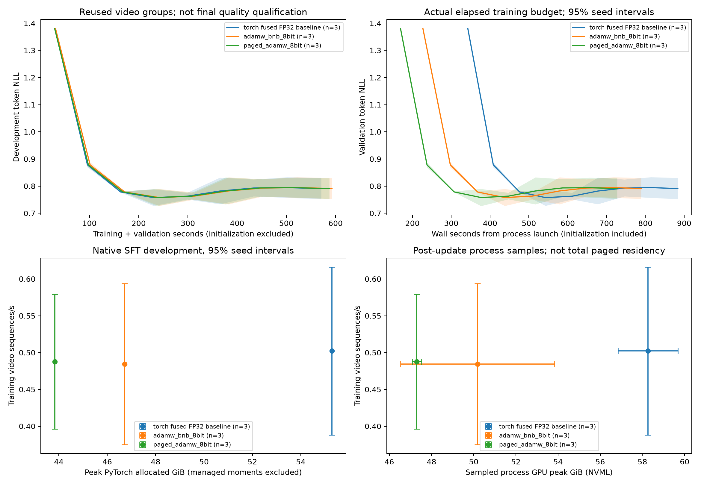
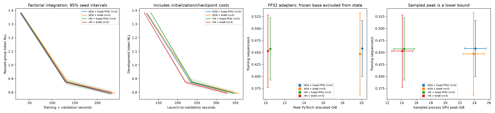

# Quantized AdamW: implementation and qualification

The feature is implemented on independent branch `feat/quantized-optimizers`,
based on upstream main `e644a833bf909af9c23a02a5c1069967dc501111` (fetched
2026-11-03). Current main `d04e5067dd2f353fa8fab65fd99fcd86819e537d` was
merged locally on 2026-11-04; its only delta is an action-cookbook documentation
change, with no runtime or dependency-pin changes. **The requested product release is not qualified:** memory savings
are measured, but speed and final task-quality confidence gates failed. All owned
training and evaluation jobs are terminal; the thresholds were not relaxed.

Main had `adamw`, `fusedadam` and `muon`; comments referring to AdamW8bit described
cosmos-rl. No equivalent native backend was found in the main/PR audit. This change
uses pinned bitsandbytes 0.49.2 and does not change model loading or architecture.
The original QLoRA checkout remains untouched and PR #334 remains closed.

## Design and supported interface

The two canonical names are `adamw_bnb_8bit` and `paged_adamw_8bit`. Both use
upstream blockwise eight-bit AdamW mathematics; only the latter requests CUDA
managed memory. `adamw_8bit` is deliberately rejected rather than introducing
another serialized identity. The primary release target is native posttrain SFT
with the HF model builder on one CUDA device.

| Contract | Implemented behavior |
|---|---|
| Base/model storage | Independent of optimizer state; ordinary mainline loading is unchanged |
| Trainables and updates | Ordinary, contiguous, nonempty CUDA FP32 parameters; no implicit master copies |
| Gradient/compute precision | FP32 parameter gradients; recipe explicitly uses BF16 autocast |
| Optimizer moments | Two uint8 arrays, FP32 block scales/maps and explicit/small-tensor exceptions |
| Paging | Separate selection; managed moments for tensors with at least 100,000 elements |
| Ownership/collectives | One rank owns live parameters, gradients and complete local state; no gradient collectives |
| Recovery | Native consolidated checkpoint transaction, same backend/version/policy/topology and group identity |
| Mainline LoRA compatibility | Existing `LoraInjectedLinear`: frozen BF16 base, FP32 trainable adapters, real CUDA tests |
| Full BF16-LoRA/NF4-QLoRA recipe | Separate disposable integration only; not a mainline loading feature |
| Explicit refusals | Multi-rank DDP/FSDP2/HSDP, DTensor, BF16/FP16 trainables, DCP, optimizer offload, sparse gradients, empty/noncontiguous parameters, closures |
| Other factories | Legacy TOML, generator and reasoner optimizer factories retain their existing choices |

BF16 trainables are rejected because this backend has no FP32 master-weight
contract equivalent to Apex FusedAdam. Saving moments cannot justify losing small
parameter updates. There is no `to_local()` conversion or advertised distributed
support. Quantization blocks and checkpoint topology are fixed to the single-device
contract; no cross-world-size reproducibility claim is made.

The factory uses final trainable parameter objects, deduplicates tied parameters
through canonical `named_parameters()` traversal, preserves existing LR/decay
groups and keeps frozen parameters out. `bnb_min_8bit_size` controls the minimum
eligible size. `bnb_fp32_state_names` accepts exact canonical trainable names;
missing, frozen, duplicate and tied-alias selectors fail. Explicit exceptions
change state precision, not trainability.

`impl` applies only to torch AdamW and must be empty for either backend. Unknown
`fused`, `foreach`, `capturable` and `amsgrad` configuration fields fail typed
validation; conflicting group flags are also rejected. Backend percentile
clipping remains 100 (disabled), leaving global clipping and gradient accumulation
to Cosmos. The whole gradient set is checked before backend mutation; nonfinite
windows cannot change moments or advance scheduler/update clocks. Lazy states for
unused parameters are retained.

Imports are lazy. Ordinary optimizers work without bitsandbytes. Preflight checks
the exact dependency, CUDA kernels, allocation path, configured strategy and
precision before expensive model construction where possible. The scratch kernel
check consumes no RNG and does not update model parameters. No fallback occurs.

## Checkpoint and allocation ownership

Native SFT releases completed gradients before entering held-out validation.
A full-model pressure canary exposed a validation OOM after two successful paged
updates while roughly 33 GiB of dead FP32 gradients remained live. Cleanup is a
separate completed-boundary operation: it refuses open accumulation and leaves
the raw evaluator's gradient/RNG preservation contract intact. The original
failure and the scoped rerun are retained. Frozen timing comparisons use their
original source; this later memory fix is identified separately.

The adapter bypasses upstream generic optimizer loading/casting. After CUDA
synchronization, snapshots copy tensor values into independent ordinary CPU
storage. They preserve uint8 states, maps, scales, counters and group configuration;
managed pointers and Python allocation attributes are not serialized. This also
provides an immutable source for the existing checkpoint transaction.

Exact restoration validates backend/version, canonical type, precision policy,
names/shapes, group order and hyperparameters. It initializes only states present
in the checkpoint, without a hidden optimizer update, and restores managed
allocations for paged moments. Schema/copy failures roll back live optimizer state.
The existing consolidated retention policy keeps only the newest optimizer by
default. Set `rl.keep_optim_last=0` when retaining multiple exact-resume points.
The factorial recovery setup initially omitted this setting; its older midpoint
was pruned. Separate correctness-only reference replays must match the original
final model/moments/data before their retained midpoints are used. They never
replace a quality or timing trial.

Switching optimizer families requires an explicit weights-only restart; it is
never accepted as exact resume. Portable model/adapter exports require no optimizer
implementation at inference time.

Pinned `get_paged` supplies a NumPy view of a native managed allocation without a
free callback. Cosmos adds a storage-lifetime owner calling the pinned native
`cudaFree`; aliases retain ownership until the last alias dies. Backend arithmetic
and synchronization remain upstream. Instance-owned override/page registries avoid
process-global settings leaking between trials. Actual allocated state counts,
bytes, lazy elements and exception reasons are logged after allocation.

## Native CLI recipe

Use the separate SFT environment, whose pins differ from the root inference
installation. Both provide the optional `quantized-optimizers` extra.

```sh
UV_PROJECT_ENVIRONMENT="$PWD/docker/posttrain/environment/.venv-sft" \
  python3 -m uv sync --project docker/posttrain/environment --frozen \
  --no-group transformers4 --group sft --group cu128-runtime \
  --extra quantized-optimizers
export PATH="$PWD/docker/posttrain/environment/.venv-sft/bin:$PATH"
export PYTHONPATH=.
SFT_MODEL_PATH=/immutable/model SFT_DATA_ROOT=/data \
IMAGINAIRE_OUTPUT_ROOT=/new/output \
torchrun --standalone --nproc-per-node=1 \
  -m cosmos_framework.posttrain.entrypoints.sft \
  --config cosmos_framework/posttrain/configs/sft_quantized_optimizer.py -- \
  rl.optimizer.name=adamw_bnb_8bit rl.optimizer.bnb_min_8bit_size=16384
```

The recipe trains decoder blocks 24–31 of Qwen3-VL-8B: 1,543,571,456 FP32 elements,
with frozen ordinary weights, microbatch 4, accumulation 1 and eight video frames.
Use `rl.optimizer.name=paged_adamw_8bit` for managed states. The matched baseline is
`rl.optimizer.name=adamw rl.optimizer.impl=fused rl.optimizer.bnb_min_8bit_size=4096`.
The last override clears the quantized-only option. Checkpoint cadence defaults to
zero for the timing comparison; `rl.save_every=10` enables dense consolidated saves.
A state exception example is
`rl.optimizer.bnb_fp32_state_names=[model.some_layer.weight]`; use the actual final
canonical name including wrapper prefixes.

## Qualification protocol and data

The fixed budget is eight GPU-hours including failures and local probes. Charge
terminal allocation elapsed time and reserve full wall limits for active/pending
jobs before admitting work. At most two campaign GPUs run on distinct nodes. All
arms within a paired seed use one verified A100-SXM4-80GB node and matched CPU/
memory requests; partially completed seed groups stay on their original nodes.
Only whole unstarted groups may move. No outcome-based reruns are allowed.

Preregistered gates use three paired seeds 17/29/43 and 95% paired-seed t intervals:
NLL ratio upper bound ≤ 1.01, task-accuracy degradation ≤ 0.01 absolute, speed-ratio
lower bound > 1.05, state-memory reduction ≥ 60%, and positive lower bound for any
claimed equal-budget quality improvement. The previous WTS NLL criterion was 1.02;
the stricter 1.01 threshold is retained. Final task analysis also uses 10,000 paired
seed/recording bootstrap draws with both within-seed and crossed recording draws.
Thresholds do not change after results.

Time to quality uses one absolute target per seed: 95% of the fused BF16 baseline's
initial validation NLL. Report both training-plus-validation time and elapsed time
from process launch, including initialization/checkpoint overhead. Equal-budget
quality uses the last completed validation before the common budget, without
interpolation. Instrumented within-run timing windows are not independent timing
restarts; they cannot establish an uninstrumented speed claim.

The user authorized reuse of the QLoRA train/eval pool. A connected-recording audit
found one recording shared across the original derived train/development split.
Those results remain in the overlap archive and fail the data integrity gate. The
repaired split has 173 train clips from 46 connected recording groups and 56 development
clips from 16 disjoint groups. Grouping joins recording families and identical-video
SHA256 matches. Regeneration from approved annotations reproduces both JSONL files
byte for byte.

The old 16-row task score shared development groups and remains development evidence.
Final task scoring instead selects 16 other connected groups from the approved full
evaluation pool by a fixed metadata-only hash rule, excluding all train/development
groups. The source pool was previously inspected; **this is not a historically
untouched test set**. Manifests, exact hashes and selection code are retained.

Mainline comparisons train 1.54B elements for 40 updates/160 video exposures. The
factorial integration trains 43,646,976 FP32 adapter elements for 16 updates/64
exposures, crossing BF16/NF4 base storage with fused FP32/nonpaged eight-bit state.
Both use substantive annotated answer text, real video and measured shapes/token
counts. Configured context limits alone are not reported as actual lengths.
Final task scoring is teacher-forced restricted-choice scoring, not free-form
answer generation. Frozen references use matching media and scoring contracts.

## Evidence and limits

For eligible N, two FP32 moments cost about 8N bytes; two uint8 arrays cost 2N plus
metadata/exceptions. Mainline allocation measures 12,348,572,000 baseline state bytes
versus 3,135,784,960 eight-bit state/metadata bytes. The adapter factorial measures
349,177,824 versus 88,659,968 bytes, approximately 248.45 MiB saved. Frozen base weights
have no optimizer state. These figures are state accounting, not total-memory
percentages; managed allocations are excluded from PyTorch allocator counters.
Device/process and host measurements accompany allocator peaks.

All nine mainline runs completed 40 updates with zero skipped updates. Paired
supervised-token order and training media/sequence shapes match exactly. Across
three seeds each arm processed 480 video sequences and 45,993 supervised tokens;
actual training sequence lengths were 679–929, with eight frames and processed
video grid `[4,16,30]` (256×480 pixels per frame).

| Mainline mode | Final NLL / fused, 95% CI | Training throughput / fused, 95% CI | Time-to-quality speed ratio, 95% CI |
|---|---|---|---|
| Nonpaged eight-bit | 1.00024 [0.99969, 1.00080] | 0.966 [0.827, 1.105] | 0.948 [0.847, 1.049] |
| Paged eight-bit | 0.99991 [0.99853, 1.00129] | 0.973 [0.842, 1.105] | 0.979 [0.865, 1.094] |

Both pass the development NLL and state-memory gates. Neither passes training
speed, matched-quality time, or equal-budget quality improvement. Launch-to-target
ratios are also inconclusive: 1.61 [−0.43, 3.66] nonpaged and 2.12 [−0.32, 4.55]
paged; negative lower endpoints reflect the preregistered unconstrained t interval,
not negative elapsed times. Initialization and cache conditions vary substantially.
The common 665-second launch budget gives NLL-improvement intervals
[−0.07070, 0.04352] and [−0.03772, 0.01909], respectively; no quality gain is established.
Mainline original-task accuracy and independent uninstrumented timing restarts
remain unqualified.

Mean post-update sampled process GPU peaks are 58.26 GiB fused, 50.18 GiB nonpaged
and 47.30 GiB paged. Paired reductions are 13.9% [7.9%, 19.8%] and
18.8% [17.0%, 20.6%], respectively. These samples are lower bounds on full-run
peaks. Available paged device-wide samples are about 3 GiB above the post-update
process readings. Seed17's device-wide peaks are 57.69 GiB fused, 48.99 GiB nonpaged
and 50.30 GiB paged; these counters have different sampling/accounting boundaries.
Only seed17 has all three device-wide traces, so there is no three-seed physical
peak-memory confidence bound. The larger paged process reduction must not be
interpreted as a complete physical-memory saving. PyTorch allocator peaks are
55.29, 46.71 and 43.83 GiB, and omit managed moments. Post-update host RSS samples are 2.30–2.55 GiB, not full-lifetime host
peaks or complete driver-managed host-page accounting. Continuous device samples
were retained where available; later allocation wrappers did not produce them,
so the report does not invent complete device-sampling coverage.

Measured optimizer calls average 30.34 ms fused, 67.93 ms nonpaged and 84.98 ms
paged. Train-and-validation preprocessing totals roughly 494–514 seconds per run;
training forward/backward totals roughly 19/34 seconds. Preprocessing dominates
this recipe, and eight-bit updates themselves are slower. Kernel width diagnostics,
precision-preserving checks and the recomputation/capacity follow-up bound the
investigation; they do not convert a failed speed gate into a pass.



All twelve disposable-integration cells completed 16 updates and final task
scoring. Both BF16 and NF4 fresh-process update8→16 continuations match the original
final model, moments, data cursor, scheduler, RNG and all eight subsequent updates
bitwise. Training exposure, media/sequence order, score masks/token counts and final
recording identities pass the analyzer's controls. Each factorial arm processed
192 training videos and 18,401 supervised tokens across the three seeds, with
actual sequence lengths 679–929.

| Eight-bit versus fused, same base | Final task-token NLL ratio, 95% CI | Training speed ratio, 95% CI | Time-to-quality speed ratio, 95% CI |
|---|---|---|---|
| BF16 base | 0.99686 [0.97208, 1.02163] | 0.975 [0.907, 1.043] | 0.961 [0.874, 1.048] |
| NF4 base | 1.00414 [0.96975, 1.03853] | 0.990 [0.965, 1.015] | 1.002 [0.955, 1.050] |

Development NLL passes for both bases, but final task-NLL upper bounds exceed the
fixed 1.01 limit. The crossed recording bootstrap also fails: one-sided upper NLL
ratios are 1.01347 and 1.02584. These failures do not prove a mean quality decline;
they mean the required bound is not established. Restricted-choice accuracy is
identical between optimizers within every seed: BF16 62.5%, 56.25%, 62.5%; NF4
56.25% for all three. Frozen references both score 56.25%. Recording-bootstrap
lower bounds on positive adaptation are zero, so that gate also fails. All
optimizer speed and equal-budget quality-gain gates fail. The common launch budget
is 299.945 seconds; equal-wall-budget NLL-gain intervals are [−0.00506, 0.00290]
for BF16 and [−0.13595, 0.08511] for NF4.

Crossing base precision separately gives mean NF4-versus-BF16 task-accuracy
degradation of 4.17 percentage points, with paired interval [−4.80, 13.13] for
either optimizer. It fails the one-percentage-point noninferiority bound; optimizer
quantization does not repair that gap. The NF4 token-NLL mean is lower on these
particular rows, which does not override the accuracy or recording-group gates.

Mean process GPU peaks are 24.12/23.87 GiB for BF16 fused/eight-bit and
14.32/14.08 GiB for NF4 fused/eight-bit. Only roughly 0.243 GiB of each difference
comes from optimizer-state savings. The approximately 9.8 GiB base-precision
difference belongs to QLoRA, not this feature. Native phase-profiler host high-water
marks are 5.84–5.93 GiB for BF16 and 6.40–6.41 GiB for NF4. The complete factorial
summary includes both optimizer effects and base-precision effects.



The 16.8M-element diagnostic, using a fused FP32 baseline, shows nonpaged throughput
ratio 0.553 (95% CI 0.539–0.566) and paged 0.506 (0.485–0.528). Both fail the speed gate.
A 67.1M-element single-matrix follow-up also fails: fused 2.919 ms, nonpaged 4.728 ms,
paged 4.855 ms, bnb32 diagnostic 2.927 ms. This bounds the investigation of launch
amortization and separates backend overhead from state quantization. It is not
multimodal task-quality evidence.


The controlled pressure probe uses 268,435,456 FP32 elements. With 256 MiB free before
state allocation, nonpaged state allocation OOMs while paged completes three
updates with 512 MiB managed moments. Resident updates take roughly 12–16 ms; pressured
updates about 169 ms. Nsight records 512 MiB evicted to host and over 20,000 GPU page
faults per measured update. This is CUDA managed memory, not disk offload. Host RSS
is not complete accounting of driver-managed host pages. Native capacity canaries
are recorded separately and cannot inherit this diagnostic's result.

The native 16-block follow-up trains 3.087B FP32 elements. Fused AdamW without
activation checkpointing OOMs during training forward at microbatches 4, 2 and 1;
nonpaged eight-bit fits microbatch 4 without checkpointing. At effective batch 4,
two updates take 15.502 seconds for fused with checkpointing versus 14.807 seconds
for eight-bit without it: a 1.047 ratio, below the 1.05 gate even before uncertainty.
These are capacity canaries, not a three-seed speed or task-quality comparison.

After the validation-gradient cleanup, the native full-model pressure pair trains
8,767,123,696 FP32 elements on the same A100 node with seed29, microbatch 1 and
checkpointing. Nonpaged state allocation OOMs. Paged completes two updates and
held-out validation, with 117/121 supervised tokens and sequence lengths 893/897.
All trainable state is initialized: 8,766,353,408 elements have quantized moments,
770,288 retain FP32 state, total moment/metadata bytes are 17,812,819,712, and
17,532,706,816 moment bytes use managed allocations. The initial allocation/update
takes 5.367 seconds and the next optimizer update 2.098 seconds; these are pressure
measurements, not a speed claim. Peak sampled values are 69.68 GiB PyTorch allocated,
75.46 GiB reserved, 76.41 GiB process GPU and 80.00 GiB device-wide, with 2.41 GiB
post-update host RSS. Their accounting boundaries differ; raw telemetry and the
native cgroup/host logs are retained. Earlier OOM/token failures and the deferred
arm remain recorded. This establishes useful paging capacity, not task quality
or complete full-lifetime physical-memory accounting.

The final focused suite passes 42 tests, followed by 55 passing regressions after
the validation-gradient fix (one Transformers-5-only test skipped locally).
Real CUDA tests cover fresh-process continuation, native SFT transactions,
accumulation/clipping/skips, LR groups, RNG/cursor/scheduler state, lazy parameters,
FP32 exceptions, tied/frozen membership, malformed-state refusal and managed
allocation lifetimes. The focused optimizer/schema/HF suite passes 38 tests, with
an additional resident paged/nonpaged equality test including large FP32 exceptions.
The unchanged HF high-precision path also passes two tests under two-rank torchrun;
this does not advertise quantized distributed support. Integration validation
includes 23 checkpoint tests, two portable-export tests and 88 native runtime tests.

All nine mainline trials, twelve factorial cells, final task scores and both
large-model recovery gates completed. The 49-job Slurm receipt includes canceled
and failed attempts: 25,538 allocated GPU-seconds plus a conservative 900-second
local allowance totals **7h20m38s**, below eight GPU-hours. No owned job remains
queued or running. The 39m22s remainder cannot reserve the next complete comparison;
the budget is not described as exhausted.

The next bounded experiment is to cache deterministic media preprocessing and
compare the 16-block fused/checkpointed and eight-bit/non-checkpointed recipes on
development data, preserving effective batch, trainables, exposure, precision,
schedule and clipping. Reserve 150 GPU-minutes for six 40-update training cells
(20 minutes each) and six task-score processes (5 minutes each), with a canary
before admission. Preserve final dense checkpoints for task scoring. This is a
proposal for a separate campaign, not an unrun result or a submitted job. A candidate
win would still require independent paired timing restarts and adequate final
evaluation at the unchanged gates. No training-speed, equal-budget quality-gain or
inference-latency claim follows from this campaign's memory savings.

## Reproduction and source identities

[Qualification commands](../../tools/quantized_optimizers/README.md) cover data
regeneration, immutable source archives, Slurm submission, collection and analysis.
[Machine-readable qualification status](evidence/quantized_optimizers/qualification_summary.json)
links each result, gate and remaining requirement.
[Provenance](evidence/quantized_optimizers/provenance.json) retains every failed,
canceled and completed allocation, dependency/source identities and budget receipts.
The mainline and integration archives are separate; the integration-only patch is
not part of the mainline runtime.

The disposable integration uses QLoRA component
`a7fd524242f4f06ac488a3d96d331b1f46e2b385`; it does not rely on the earlier reported
`e52aa73` or closed PR #334 as qualification. Its native runtime uses Torch 2.11.0+cu128,
Transformers 5.8.1 and bitsandbytes 0.49.2. Local CUDA tests use Torch 2.10.0+cu130.
Exact source/archive/wheel and model/data hashes are recorded with each comparison.

Primary references: [pinned AdamW source](https://github.com/bitsandbytes-foundation/bitsandbytes/blob/0.49.2/bitsandbytes/optim/adamw.py),
[pinned optimizer allocation/update source](https://github.com/bitsandbytes-foundation/bitsandbytes/blob/0.49.2/bitsandbytes/optim/optimizer.py),
[AdamW API](https://huggingface.co/docs/bitsandbytes/en/reference/optim/adamw),
[optimizer guide](https://huggingface.co/docs/bitsandbytes/en/optimizers),
[paging explanation](https://huggingface.co/docs/bitsandbytes/explanations/optimizers),
[Cosmos configuration](https://nvidia.github.io/cosmos-framework/posttrain/reference/config/).
The [Transformers 5.8.1 alias](https://github.com/huggingface/transformers/blob/v5.8.1/src/transformers/training_args.py)
`adamw_8bit` names bitsandbytes, not an Apex eight-bit implementation.
