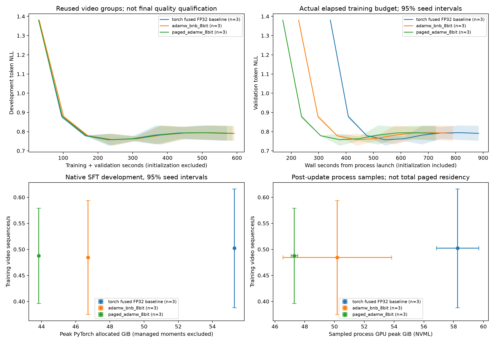
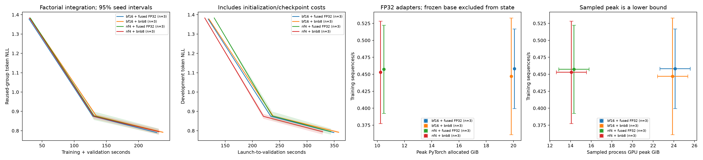
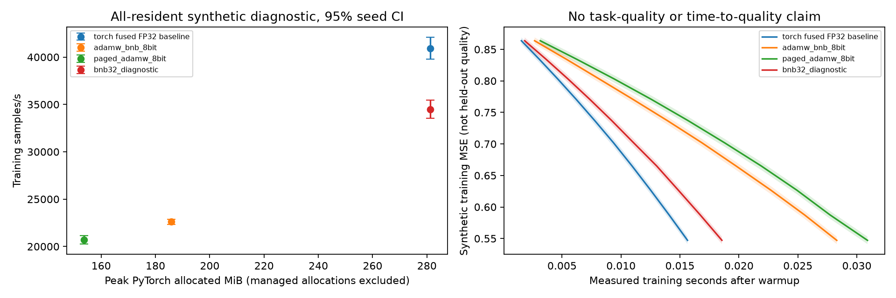
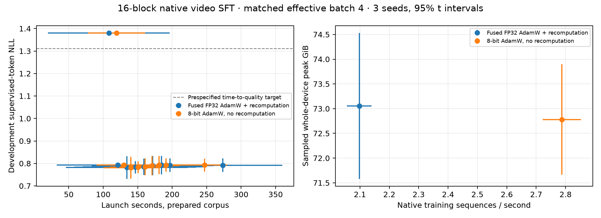
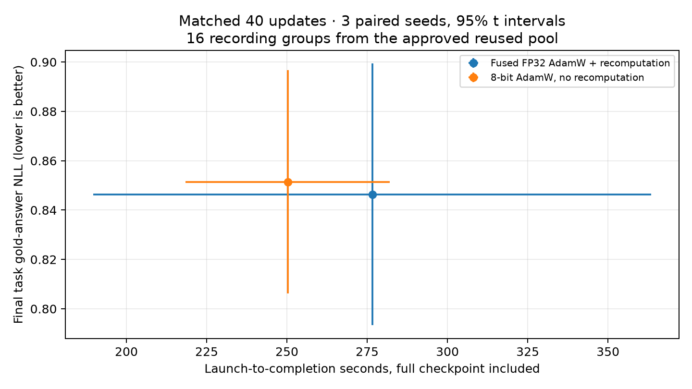
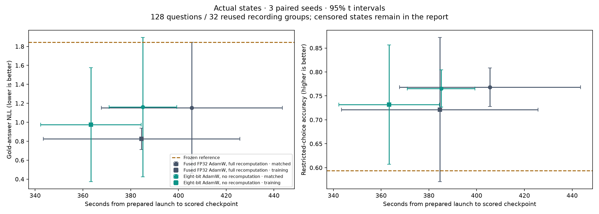
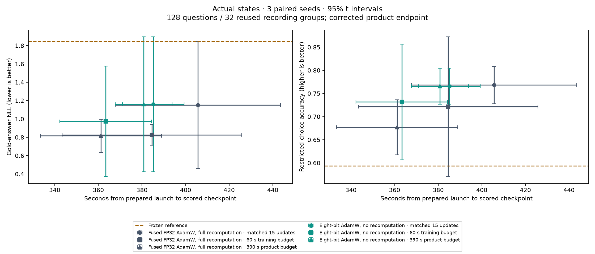
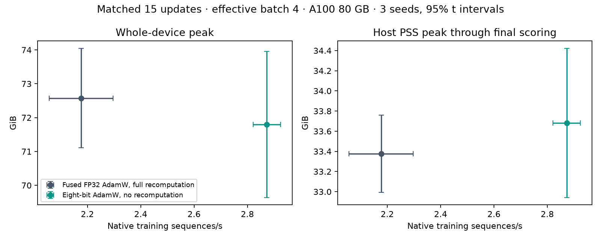
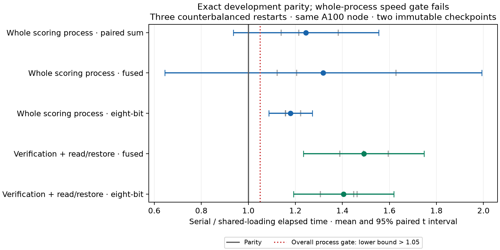

# Quantized AdamW: implementation and qualification

The feature is implemented on independent branch `feat/quantized-optimizers`,
based on upstream main `e644a833bf909af9c23a02a5c1069967dc501111` (fetched
2026-11-03). Current main `d04e5067dd2f353fa8fab65fd99fcd86819e537d` was
merged locally on 2026-11-04; its only delta is an action-cookbook documentation
change, with no runtime or dependency-pin changes. **The requested product release is not qualified:** state-memory savings
and a deployment training-loop throughput gain are measured, but end-to-end
time-to-quality and final task-quality confidence gates failed in the first two
campaigns. Those allocations are terminal. The [outcome-improvement campaign](#outcome-improvement-campaign)
closes the dense recovery gap and demonstrates positive adaptation. Its 36-run
comparison and the separately corrected product-budget endpoint are complete.
Equal-product-budget accuracy improves, but its NLL-gain requirement, matched
quality guards and end-to-end speed guards remain unmet. The thresholds
have not been relaxed.

Main had `adamw`, `fusedadam` and `muon`; comments referring to AdamW8bit described
cosmos-rl. No equivalent native backend was found in the main/PR audit. This change
uses pinned bitsandbytes 0.49.2 without model-weight quantization or architecture changes.
Shared loading improvements in the third campaign preserve native values and predictions.
The original QLoRA checkout remains untouched and PR #334 remains closed.

## Design and supported interface

The two canonical names are `adamw_bnb_8bit` and `paged_adamw_8bit`. Both use
upstream blockwise eight-bit AdamW mathematics; only the latter requests CUDA
managed memory. `adamw_8bit` is deliberately rejected rather than introducing
another serialized identity. The original qualified training target is native posttrain SFT
with the HF model builder on one CUDA device. The explicit `fp32_master` policy
adds shared BF16/FSDP2 update ownership for native action-policy integration;
its infrastructure evidence and model-specific limits are separated below.

The existing `update_policy=parameter` contract remains:

| Contract | Implemented behavior |
|---|---|
| Base/model storage | Independent of optimizer state; ordinary models need no weight quantization |
| Trainables and updates | Ordinary, contiguous, nonempty CUDA FP32 parameters; no implicit master copies |
| Gradient/compute precision | FP32 parameter gradients; recipe explicitly uses BF16 autocast |
| Optimizer moments | Two uint8 arrays, FP32 block scales/maps and explicit/small-tensor exceptions |
| Paging | Separate selection; managed moments for tensors with at least 100,000 elements |
| Ownership/collectives | One rank owns live parameters, gradients and complete local state; no gradient collectives |
| Recovery | Native consolidated checkpoint transaction, same backend/version/policy/topology and group identity |
| Mainline LoRA compatibility | Existing `LoraInjectedLinear`: frozen BF16 base, FP32 trainable adapters, real CUDA tests |
| Full BF16-LoRA/NF4-QLoRA recipe | Separate disposable integration only; not a mainline loading feature |
| Explicit refusals | Multi-rank DDP/FSDP2/HSDP, DTensor, BF16/FP16 trainables, DCP, optimizer offload, sparse gradients, empty/noncontiguous parameters, closures |
| Other factories | Legacy TOML, generator and reasoner optimizer factories retain their existing choices |

With `update_policy=parameter`, BF16 trainables are rejected because the backend has no FP32 master-weight
contract equivalent to Apex FusedAdam. Saving moments cannot justify losing small
parameter updates. The original ordinary-parameter route has no local-shard conversion. Its
quantization blocks and checkpoint topology remain fixed to the single-device
contract; no cross-world-size reproducibility claim is made.

The factory uses final trainable parameter objects, deduplicates tied parameters
through canonical `named_parameters()` traversal, preserves existing LR/decay
groups and keeps frozen parameters out. `bnb_min_8bit_size` controls the minimum
eligible size. `bnb_fp32_state_names` accepts exact canonical trainable names;
missing, frozen, duplicate and tied-alias selectors fail. Explicit exceptions
change state precision, not trainability.

`impl` applies only to torch AdamW and must be empty for either backend. Unknown
`fused`, `foreach`, `capturable` and `amsgrad` configuration fields fail typed
validation; conflicting group flags are also rejected. Backend percentile
clipping remains 100 (disabled), leaving global clipping and gradient accumulation
to Cosmos. The whole gradient set is checked before backend mutation; nonfinite
windows cannot change moments or advance scheduler/update clocks. Lazy states for
unused parameters are retained.

Imports are lazy. Ordinary optimizers work without bitsandbytes. Preflight checks
the exact dependency, CUDA kernels, allocation path, configured strategy and
precision before expensive model construction where possible. The scratch kernel
check consumes no RNG and does not update model parameters. No fallback occurs.

## Checkpoint and allocation ownership

Native SFT releases completed gradients before entering held-out validation.
A full-model pressure canary exposed a validation OOM after two successful paged
updates while roughly 33 GiB of dead FP32 gradients remained live. Cleanup is a
separate completed-boundary operation: it refuses open accumulation and leaves
the raw evaluator's gradient/RNG preservation contract intact. The original
failure and the scoped rerun are retained. Frozen timing comparisons use their
original source; this later memory fix is identified separately.

The adapter bypasses upstream generic optimizer loading/casting. After CUDA
synchronization, snapshots copy tensor values into independent ordinary CPU
storage. They preserve uint8 states, maps, scales, counters and group configuration;
managed pointers and Python allocation attributes are not serialized. This also
provides an immutable source for the existing checkpoint transaction.

Ordinary-parameter full checkpoints remain synchronous: the model state aliases
live device tensors, so the native trainer declines asynchronous publication even
when the optimizer snapshot is independent. Qualification charges the complete
save. The current matrix does not claim background full-model checkpointing.

Exact restoration validates backend/version, canonical type, precision policy,
names/shapes, group order and hyperparameters. It initializes only states present
in the checkpoint, without a hidden optimizer update, and restores managed
allocations for paged moments. Schema/copy failures roll back live optimizer state.
The existing consolidated retention policy keeps only the newest optimizer by
default. Set `rl.keep_optim_last=0` when retaining multiple exact-resume points.
The factorial recovery setup initially omitted this setting; its older midpoint
was pruned. Separate correctness-only reference replays must match the original
final model/moments/data before their retained midpoints are used. They never
replace a quality or timing trial.

Switching optimizer families requires an explicit weights-only restart; it is
never accepted as exact resume. Portable model/adapter exports require no optimizer
implementation at inference time.

Pinned `get_paged` supplies a NumPy view of a native managed allocation without a
free callback. Cosmos adds a storage-lifetime owner calling the pinned native
`cudaFree`; aliases retain ownership until the last alias dies. Backend arithmetic
and synchronization remain upstream. Instance-owned override/page registries avoid
process-global settings leaking between trials. Actual allocated state counts,
bytes, lazy elements and exception reasons are logged after allocation.

## Native CLI recipe

Use the separate SFT environment, whose pins differ from the root inference
installation. Both provide the optional `quantized-optimizers` extra.

```sh
UV_PROJECT_ENVIRONMENT="$PWD/docker/posttrain/environment/.venv-sft" \
  python3 -m uv sync --project docker/posttrain/environment --frozen \
  --no-group transformers4 --group sft --group cu128-runtime \
  --extra quantized-optimizers
export PATH="$PWD/docker/posttrain/environment/.venv-sft/bin:$PATH"
export PYTHONPATH=.
SFT_MODEL_PATH=/immutable/model SFT_DATA_ROOT=/data \
IMAGINAIRE_OUTPUT_ROOT=/new/output \
torchrun --standalone --nproc-per-node=1 \
  -m cosmos_framework.posttrain.entrypoints.sft \
  --config cosmos_framework/posttrain/configs/sft_quantized_optimizer.py -- \
  rl.optimizer.name=adamw_bnb_8bit rl.optimizer.bnb_min_8bit_size=16384
```

The recipe trains decoder blocks 24–31 of Qwen3-VL-8B: 1,543,571,456 FP32 elements,
with frozen ordinary weights, microbatch 4, accumulation 1 and eight video frames.
Use `rl.optimizer.name=paged_adamw_8bit` for managed states. The matched baseline is
`rl.optimizer.name=adamw rl.optimizer.impl=fused rl.optimizer.bnb_min_8bit_size=4096`.
The last override clears the quantized-only option. Checkpoint cadence defaults to
zero for the timing comparison; `rl.save_every=10` enables dense consolidated saves.
A state exception example is
`rl.optimizer.bnb_fp32_state_names=[model.some_layer.weight]`; use the actual final
canonical name including wrapper prefixes.

## Qualification protocol and data

The first campaign's fixed budget is eight GPU-hours including failures and local probes. Charge
terminal allocation elapsed time and reserve full wall limits for active/pending
jobs before admitting work. At most two campaign GPUs run on distinct nodes. All
arms within a paired seed use one verified A100-SXM4-80GB node and matched CPU/
memory requests; partially completed seed groups stay on their original nodes.
Only whole unstarted groups may move. No outcome-based reruns are allowed.

Preregistered gates use three paired seeds 17/29/43 and 95% paired-seed t intervals:
NLL ratio upper bound ≤ 1.01, task-accuracy degradation ≤ 0.01 absolute, speed-ratio
lower bound > 1.05, state-memory reduction ≥ 60%, and positive lower bound for any
claimed equal-budget quality improvement. The previous WTS NLL criterion was 1.02;
the stricter 1.01 threshold is retained. Final task analysis also uses 10,000 paired
seed/recording bootstrap draws with both within-seed and crossed recording draws.
Thresholds do not change after results.

Time to quality uses one absolute target per seed: 95% of the fused BF16 baseline's
initial validation NLL. Report both training-plus-validation time and elapsed time
from process launch, including initialization/checkpoint overhead. Equal-budget
quality uses the last completed validation before the common budget, without
interpolation. Instrumented within-run timing windows are not independent timing
restarts; they cannot establish an uninstrumented speed claim.

The user authorized reuse of the QLoRA train/eval pool. A connected-recording audit
found one recording shared across the original derived train/development split.
Those results remain in the overlap archive and fail the data integrity gate. The
repaired split has 173 train clips from 46 connected recording groups and 56 development
clips from 16 disjoint groups. Grouping joins recording families and identical-video
SHA256 matches. Regeneration from approved annotations reproduces both JSONL files
byte for byte.

The old 16-row task score shared development groups and remains development evidence.
Final task scoring instead selects 16 other connected groups from the approved full
evaluation pool by a fixed metadata-only hash rule, excluding all train/development
groups. The source pool was previously inspected; **this is not a historically
untouched test set**. Manifests, exact hashes and selection code are retained.

Mainline comparisons train 1.54B elements for 40 updates/160 video exposures. The
factorial integration trains 43,646,976 FP32 adapter elements for 16 updates/64
exposures, crossing BF16/NF4 base storage with fused FP32/nonpaged eight-bit state.
Both use substantive annotated answer text, real video and measured shapes/token
counts. Configured context limits alone are not reported as actual lengths.
Final task scoring is teacher-forced restricted-choice scoring, not free-form
answer generation. Frozen references use matching media and scoring contracts.

## Evidence and limits

For eligible N, two FP32 moments cost about 8N bytes; two uint8 arrays cost 2N plus
metadata/exceptions. Mainline allocation measures 12,348,572,000 baseline state bytes
versus 3,135,784,960 eight-bit state/metadata bytes. The adapter factorial measures
349,177,824 versus 88,659,968 bytes, approximately 248.45 MiB saved. Frozen base weights
have no optimizer state. These figures are state accounting, not total-memory
percentages; managed allocations are excluded from PyTorch allocator counters.
Device/process and host measurements accompany allocator peaks.

All nine mainline runs completed 40 updates with zero skipped updates. Paired
supervised-token order and training media/sequence shapes match exactly. Across
three seeds each arm processed 480 video sequences and 45,993 supervised tokens;
actual training sequence lengths were 679–929, with eight frames and processed
video grid `[4,16,30]` (256×480 pixels per frame).

| Mainline mode | Final NLL / fused, 95% CI | Training throughput / fused, 95% CI | Time-to-quality speed ratio, 95% CI |
|---|---|---|---|
| Nonpaged eight-bit | 1.00024 [0.99969, 1.00080] | 0.966 [0.827, 1.105] | 0.948 [0.847, 1.049] |
| Paged eight-bit | 0.99991 [0.99853, 1.00129] | 0.973 [0.842, 1.105] | 0.979 [0.865, 1.094] |

Both pass the development NLL and state-memory gates. Neither passes training
speed, matched-quality time, or equal-budget quality improvement. Launch-to-target
ratios are also inconclusive: 1.61 [−0.43, 3.66] nonpaged and 2.12 [−0.32, 4.55]
paged; negative lower endpoints reflect the preregistered unconstrained t interval,
not negative elapsed times. Initialization and cache conditions vary substantially.
The common 665-second launch budget gives NLL-improvement intervals
[−0.07070, 0.04352] and [−0.03772, 0.01909], respectively; no quality gain is established.
Mainline original-task accuracy and independent uninstrumented timing restarts
remain unqualified.

Mean post-update sampled process GPU peaks are 58.26 GiB fused, 50.18 GiB nonpaged
and 47.30 GiB paged. Paired reductions are 13.9% [7.9%, 19.8%] and
18.8% [17.0%, 20.6%], respectively. These samples are lower bounds on full-run
peaks. Available paged device-wide samples are about 3 GiB above the post-update
process readings. Seed17's device-wide peaks are 57.69 GiB fused, 48.99 GiB nonpaged
and 50.30 GiB paged; these counters have different sampling/accounting boundaries.
Only seed 17 has all three device-wide traces, so there is no three-seed physical
peak-memory confidence bound. The larger paged process reduction must not be
interpreted as a complete physical-memory saving. PyTorch allocator peaks are
55.29, 46.71 and 43.83 GiB, and omit managed moments. Post-update host RSS samples are 2.30–2.55 GiB, not full-lifetime host
peaks or complete driver-managed host-page accounting. Continuous device samples
were retained where available; later allocation wrappers did not produce them,
so the report does not invent complete device-sampling coverage.

Measured optimizer calls average 30.34 ms fused, 67.93 ms nonpaged and 84.98 ms
paged. Train-and-validation preprocessing totals roughly 494–514 seconds per run;
training forward/backward totals roughly 19/34 seconds. Preprocessing dominates
this recipe, and eight-bit updates themselves are slower. Kernel width diagnostics,
precision-preserving checks and the recomputation/capacity follow-up bound the
investigation; they do not convert a failed speed gate into a pass.



All twelve disposable-integration cells completed 16 updates and final task
scoring. Both BF16 and NF4 fresh-process update8→16 continuations match the original
final model, moments, data cursor, scheduler, RNG and all eight subsequent updates
bitwise. Training exposure, media/sequence order, score masks/token counts and final
recording identities pass the analyzer's controls. Each factorial arm processed
192 training videos and 18,401 supervised tokens across the three seeds, with
actual sequence lengths 679–929.

| Eight-bit versus fused, same base | Final task-token NLL ratio, 95% CI | Training speed ratio, 95% CI | Time-to-quality speed ratio, 95% CI |
|---|---|---|---|
| BF16 base | 0.99686 [0.97208, 1.02163] | 0.975 [0.907, 1.043] | 0.961 [0.874, 1.048] |
| NF4 base | 1.00414 [0.96975, 1.03853] | 0.990 [0.965, 1.015] | 1.002 [0.955, 1.050] |

Development NLL passes for both bases, but final task-NLL upper bounds exceed the
fixed 1.01 limit. The crossed recording bootstrap also fails: one-sided upper NLL
ratios are 1.01347 and 1.02584. These failures do not prove a mean quality decline;
they mean the required bound is not established. Restricted-choice accuracy is
identical between optimizers within every seed: BF16 62.5%, 56.25%, 62.5%; NF4
56.25% for all three. Frozen references both score 56.25%. Recording-bootstrap
lower bounds on positive adaptation are zero, so that gate also fails. All
optimizer speed and equal-budget quality-gain gates fail. The common launch budget
is 299.945 seconds; equal-wall-budget NLL-gain intervals are [−0.00506, 0.00290]
for BF16 and [−0.13595, 0.08511] for NF4.

Crossing base precision separately gives mean NF4-versus-BF16 task-accuracy
degradation of 4.17 percentage points, with paired interval [−4.80, 13.13] for
either optimizer. It fails the one-percentage-point noninferiority bound; optimizer
quantization does not repair that gap. The NF4 token-NLL mean is lower on these
particular rows, which does not override the accuracy or recording-group gates.

Mean process GPU peaks are 24.12/23.87 GiB for BF16 fused/eight-bit and
14.32/14.08 GiB for NF4 fused/eight-bit. Only roughly 0.243 GiB of each difference
comes from optimizer-state savings. The approximately 9.8 GiB base-precision
difference belongs to QLoRA, not this feature. Native phase-profiler host high-water
marks are 5.84–5.93 GiB for BF16 and 6.40–6.41 GiB for NF4. The complete factorial
summary includes both optimizer effects and base-precision effects.



The 16.8M-element diagnostic, using a fused FP32 baseline, shows nonpaged throughput
ratio 0.553 (95% CI 0.539–0.566) and paged 0.506 (0.485–0.528). Both fail the speed gate.
A 67.1M-element single-matrix follow-up also fails: fused 2.919 ms, nonpaged 4.728 ms,
paged 4.855 ms, bnb32 diagnostic 2.927 ms. This bounds the investigation of launch
amortization and separates backend overhead from state quantization. It is not
multimodal task-quality evidence.



The controlled pressure probe uses 268,435,456 FP32 elements. With 256 MiB free before
state allocation, nonpaged state allocation OOMs while paged completes three
updates with 512 MiB managed moments. Resident updates take roughly 12–16 ms; pressured
updates about 169 ms. Nsight records 512 MiB evicted to host and over 20,000 GPU page
faults per measured update. This is CUDA managed memory, not disk offload. Host RSS
is not complete accounting of driver-managed host pages. Native capacity canaries
are recorded separately and cannot inherit this diagnostic's result.

The native 16-block follow-up trains 3.087B FP32 elements. Fused AdamW without
activation checkpointing OOMs during training forward at microbatches 4, 2 and 1;
nonpaged eight-bit fits microbatch 4 without checkpointing. At effective batch 4,
two updates take 15.502 seconds for fused with checkpointing versus 14.807 seconds
for eight-bit without it: a 1.047 ratio, below the 1.05 gate even before uncertainty.
These are capacity canaries, not a three-seed speed or task-quality comparison.

After the validation-gradient cleanup, the native full-model pressure pair trains
8,767,123,696 FP32 elements on the same A100 node with seed 29, microbatch 1 and
checkpointing. Nonpaged state allocation OOMs. Paged completes two updates and
held-out validation, with 117/121 supervised tokens and sequence lengths 893/897.
All trainable state is initialized: 8,766,353,408 elements have quantized moments,
770,288 retain FP32 state, total moment/metadata bytes are 17,812,819,712, and
17,532,706,816 moment bytes use managed allocations. The initial allocation/update
takes 5.367 seconds and the next optimizer update 2.098 seconds; these are pressure
measurements, not a speed claim. Peak sampled values are 69.68 GiB PyTorch allocated,
75.46 GiB reserved, 76.41 GiB process GPU and 80.00 GiB device-wide, with 2.41 GiB
post-update host RSS. Their accounting boundaries differ; raw telemetry and the
native cgroup/host logs are retained. Earlier OOM/token failures and the deferred
arm remain recorded. This establishes useful paging capacity, not task quality
or complete full-lifetime physical-memory accounting.

The final focused suite passes 42 tests, followed by 55 passing regressions after
the validation-gradient fix (one Transformers-5-only test skipped locally).
Real CUDA tests cover fresh-process continuation, native SFT transactions,
accumulation/clipping/skips, LR groups, RNG/cursor/scheduler state, lazy parameters,
FP32 exceptions, tied/frozen membership, malformed-state refusal and managed
allocation lifetimes. The focused optimizer/schema/HF suite passes 38 tests, with
an additional resident paged/nonpaged equality test including large FP32 exceptions.
The unchanged HF high-precision path also passes two tests under two-rank torchrun;
this does not advertise quantized distributed support. Integration validation
includes 23 checkpoint tests, two portable-export tests and 88 native runtime tests.

All nine mainline trials, twelve factorial cells, final task scores and both
large-model recovery gates completed. The 49-job Slurm receipt includes canceled
and failed attempts: 25,538 allocated GPU-seconds plus a conservative 900-second
local allowance totals **7h20m38s**, below eight GPU-hours. No owned job remains
queued or running. The 39m22s remainder cannot reserve the next complete comparison;
the budget is not described as exhausted.

## Completed deployment follow-up

The authorized follow-up kept a separate **150 GPU-minute** cap and unchanged
quality/performance thresholds. It trained decoder blocks 16–31: **3,087,142,912
FP32 trainable elements**, with BF16 forward compute, eight real video frames,
microbatch four, no accumulation, 40 updates and a matched cosine schedule.
Fused FP32 AdamW uses activation checkpointing; nonpaged eight-bit AdamW uses the
saved state memory to disable it. The earlier capacity checks established that
fused AdamW without checkpointing does not fit this model even at microbatch one.
This is the deployment comparison; the first campaign remains the optimizer
isolation comparison. No QLoRA loading feature is used in this follow-up.

Both arms consume the same immutable native CPU inputs. The optional
`rl.prepared_corpus` interface verifies processor/source/media/content identities,
rejects missing or modified entries, and binds the corpus digest into exact resume.
The native packer independently reproduced all 245 prepared rows exactly. A real
four-update raw/prepared fused canary then matched model, optimizer, scheduler,
cursor, RNG and update state bit for bit. Preparation plus independent replay took
812.126 CPU-wall seconds; that shared cost is included in the cold-pipeline clock.
It is not attributed to optimizer quantization.

The optional `rl.strict_determinism=true` requires `rl.deterministic=true` and
requests deterministic kernels instead of warning-only behavior. The old default
is preserved. Set `CUBLAS_WORKSPACE_CONFIG=:4096:8` and `PYTHONHASHSEED=42` in the
launch environment. The initial warning-only canary was stopped and remains in
cost accounting. Both timed arms use the same strict setting.

All **18 native training runs** completed: three paired seeds, three paired
process restarts per seed, two optimizers. Every run saved a full checkpoint and
had zero skipped updates. All **72 repeat-checkpoint value comparisons** passed
for model, optimizer, scheduler, data cursor, RNG and update count. Timing repeats
are averaged within seed before the three-seed confidence interval; they do not
inflate the quality sample count. All seven final score files are complete: one
frozen reference and the two fixed restart-zero checkpoints for each seed.

Per arm and restart, the three seeds process 480 video sequences and 45,993
supervised tokens. Actual sequence lengths are 679–929, video payload shape is
`[1920,1536]`, and the video grid is `[4,16,30]`, corresponding to eight 256×480
frames. Each arm's three restarts repeat those exposures exactly. The final task
uses 16 recording-disjoint groups, excluding training, development and the first
campaign's final groups. These come from the user-approved historically inspected
pool, so they are not an untouched test set. Final task scoring is teacher-forced.

| Follow-up statistic | Estimate and 95% interval | Fixed gate |
|---|---|---|
| Native training throughput / fused | **1.329 [1.304, 1.353]** | Pass for this training-loop measurement |
| Launch-to-completion ratio, full checkpoint included | 1.136 [0.702, 1.570] | No demonstrated end-to-end win |
| Native time-to-quality ratio | 1.176 [0.824, 1.528] | Fail |
| Launch time-to-quality ratio | 1.023 [0.243, 1.803] | Fail |
| Cold-pipeline time-to-quality ratio | 0.993 [0.898, 1.088] | Fail |
| Development NLL / fused | 1.00028 [0.99875, 1.00181] | Pass ≤1.01 |
| Final task answer NLL / fused | **1.00618 [0.96976, 1.04260]** | Fail ≤1.01 |

The crossed seed/recording bootstrap also fails final task NLL, with interval
[0.98870, 1.02695]. Both optimizers have the same task accuracies by seed: 50%, 50%
and 56.25%; their measured paired accuracy difference is zero. The frozen reference
scores 68.75%. The adaptation interval is −43.75 to +10.42 percentage points, so
positive adaptation is not established. These small, reused groups cannot establish
an independent release-quality claim.

At equal native training/validation time, the development NLL improvement is
0.000061 with interval [−0.03474, 0.03487]. One slow-loading fused repeat had not
completed its initial validation by the common launch/cold budget. Those equal-time
comparisons are censored and fail the gain gate; missing quality is not imputed.
Final task scores exist at matched update 40, not at both arms' equal-time stopping
points. **No held-out equal-budget quality gain is claimed.**





The allocation canary measures **24,697,144,000 state bytes fused versus
6,271,567,872 eight-bit bytes**, including metadata and exceptions: about **74.61%
less optimizer state**. Of the trainable elements, 3,087,007,744 have quantized
moments and 135,168 retain FP32 state; none are uninitialized. The serialized-state
count is slightly larger because copied quantization maps occur in multiple entries.
There are no master copies beyond the FP32 trainable parameters.

The saved memory is spent on avoiding recomputation. Across the full timing runs,
sampled whole-device peaks average 73.06 GiB fused versus 72.78 GiB eight-bit; the
paired reduction is 0.37% with interval [−1.68%, 2.43%], so total device-peak reduction
is not established for this deployment configuration. Process GPU peaks are
72.37 versus 72.10 GiB. Host process-tree PSS peaks increase from 6.17 to 10.66 GiB.
The quantized adapter takes an eager independent CPU state snapshot for checkpoint
correctness, which is consistent with this host-memory cost. PSS excludes unmapped
filesystem cache; native cgroup readings and raw traces are retained. The earlier
isolation comparison's measured device/process savings remain separate evidence.

The pinned native CPU regression suite passes 73 tests with one optional skip;
seven local qualification-control tests also pass. The earlier real-CUDA optimizer,
small native transaction and large adapter integration recovery tests retain their
scope. An additional dense 40→44 fresh-process check was canceled after 188 GPU-seconds,
before any training optimizer update: its launcher omitted `keep_optim_last=0`, needed when
native SFT also saves at the final step 44. The corrected launcher preserves the
midpoint and avoids a redundant resumed export, but its full rerun is **not qualified**.
It does not replace the completed timing or quality runs.

All 16 follow-up Slurm allocations are terminal. Actual cost is **8,632 GPU-seconds
(2h23m52s)**, including failed and canceled attempts, and 1,678 CPU-wall seconds
against the 1,800-second CPU cap. Six minutes eight seconds remain under the GPU
cap, which cannot reserve the complete additional recovery check. Slurm rounded
fractional-minute requests upward; the retained audit records a seven-second excess
in an earlier planned reservation total (9,007 versus 9,000 seconds), while actual
spending remained below the cap. The ledger now uses effective wall limits.

Two original combined allocations timed out during qualification after their
training and repeat hashes completed. Completed score commits were validated and
retained, and only the missing score was run separately. The final seed used
separate training, CPU verification and GPU scoring allocations. Native source-tree,
training-launch and scoring-math hashes prove the split did not change training or
metrics. All negative results and unsuccessful attempts remain in the
[machine-readable evidence](evidence/quantized_optimizers_round2/summary.json).

At the round-two handoff, task-NLL confidence, end-to-end time-to-quality,
equal-budget quality and the extra dense recovery check remained open. The next
section records completion of that recovery check, shared loading improvements
and actual equal-time evaluations while preserving the failed thresholds.
Independent replication additionally needs
sealed recording/trajectory groups not previously inspected or used in the QLoRA
pool, with gold annotations, original media and a content/recording manifest, sized
to resolve the existing 1% quality margin. No training result here establishes lower
inference latency.

## Outcome-improvement campaign

The third campaign continues from local `1d250b4` on the independent optimizer
branch. Its [fixed budget and gates](evidence/quantized_optimizers_round3/plan.json)
allow 28,800 GPU-seconds and 7,200 CPU-wall seconds, including failed allocations.
Local commits are authorized; no push or new PR publication is authorized.

The dense recovery gap described in the round-two handoff above is now closed.
Both fused and nonpaged eight-bit native reference 44/resume 40→44 pairs passed:
every live parameter, moment/scale/map, scheduler/update counter, RNG and data
cursor matches after updates 41, 42, 43 and 44, and the complete final model matches.
The reference retains both 40 and 44 with `keep_optim_last=0`; resume performs no
unrecorded update. The original failed diagnostic attempts remain in the ledger.
See the [fused](evidence/quantized_optimizers_round3/recovery_fused_raw.json.gz)
and [eight-bit](evidence/quantized_optimizers_round3/recovery_8bit_raw.json.gz) raw evidence.

A separate restore defect was fixed: group-metadata snapshot failure could occur
after live moments had been replaced. Metadata is now staged before live mutation.
Real CUDA failure-injection tests cover both partial moment copying and group
metadata failure in paged and nonpaged modes, preserving original allocation
ownership, state/group identity and the next update. The pinned regression suite
passes 49 tests; seven additional weight-loading tests also pass.

The task audit found an annotation conversion defect: the final option could
include the evaluation-only instruction footer. It affected 870 of 2,676 gold
answer texts and all 56 substantive development rows. Training 173-row bytes were
unchanged; the historical single-letter task scorer was unaffected. Those old
accuracy/NLL results are retained. Answer-position alignment, ordered class/token
mapping, end-token handling, loss masks, actual video inputs, model identity and
frozen-reference construction were checked.

The original training target asks multiple numbered questions and supervises
answer text; task scoring asks one original question and requires its letter.
The selected shared recipe retains every substantive target and adds one original
single-choice question per training video. `ce_exponent=1` gives equal row weight;
this jointly changes objective mix and weighting, rather than isolating either
factor. The high-precision development control reached 87.5% accuracy at update 15,
versus 46.875% frozen. Development NLL worsened by update 20, so the duration remains 15.
At 15, eight-bit/fused development task NLL is 0.519571/0.522715 and both accuracies
are 87.5%. These are development observations, not final quality qualification.
The [complete curves](evidence/quantized_optimizers_round3/development_curves.json)
and [paired screen](evidence/quantized_optimizers_round3/paired_development15_summary.json)
retain the substantive-only and lower-LR controls.

Across the three seeds, development accuracy at update 15 matches between
optimizers (87.5%, 84.375%, 78.125%), with slightly lower eight-bit task NLL in
each seed. These quality observations do not justify adopting additional
FP32-state exceptions.
Both arms show late NLL deterioration for seed 29. A separately locked development
probe shortened the cosine horizon from 40 to 15 while keeping the same 15 updates,
initial LR, data order and trainables. It helped seed 29's NLL but worsened mean
task NLL by 4.31%, reduced accuracy in all three seeds and worsened substantive
NLL in two. The candidate failed its prespecified guards and was rejected without
new final scoring. Its [raw results and decision](evidence/quantized_optimizers_round3/short_schedule_summary.json)
and 812 GPU-seconds remain in the evidence and ledger.

The [development confidence audit](evidence/quantized_optimizers_round3/development_confidence.json)
helps explain the accuracy/NLL trade-off. For seed 29, both arms improve accuracy
from 78.125% at update10 to 84.375% at update15 while NLL worsens. On the largest
shared deteriorating example, the same wrong letter remains selected: its
four-choice probability rises from about 0.80/0.78 to 0.99956, and gold-answer
NLL rises from 1.60/1.50 to 7.75 for fused/eight-bit. This is evidence of a shared
confidence problem on development data, not proof of a quantization defect or a
label error. All inputs/gold mappings are unchanged; per-question records and
all six development curves are retained. The next shared LR candidate is based
on these development curves, without post-hoc final checkpoint selection.

A [native arithmetic diagnostic](evidence/quantized_optimizers_round3/native_arithmetic_summary.json)
compared fused AdamW, bitsandbytes FP32-state AdamW and eight-bit AdamW under
identical full recomputation for seed 17 and 15 updates. All three reached 87.5%
development accuracy; task NLL was 0.522715, 0.524023 and 0.519571 respectively.
The FP32-state control uses the supported minimum-size setting above every
trainable tensor, with zero quantized state elements verified after allocation.
It does not introduce another public optimizer name.

CUDA comparisons cover all 176 trainable tensors against the exact pretrained
initial values. Cumulative update relative L2 differences are 2.24% for
fused versus bitsandbytes FP32 state and 3.48% for bitsandbytes FP32 versus eight-bit
state. These include gradient feedback across 15 updates; they are not single-step
kernel errors. The largest absolute latter difference is 0.003458 in layer31's
V projection. Six of the seven largest absolute differences are in K/V projections,
motivating a bounded development test of FP32 moments for those 32 tensors. Neither
the arithmetic comparison nor development accuracy can pass the failed final
quality guards.

The [three-seed K/V precision screen](evidence/quantized_optimizers_round3/kv_precision_summary.json)
completed and was rejected. FP32 moments for the 32 K/V projections preserve
87.5%, 84.375% and 78.125% development accuracy, but mean task NLL worsens 1.805%
instead of meeting the locked 2% improvement requirement. Substantive NLL and
state-accounting checks pass. Actual tensor state is 7,072,679,936 bytes, a 71.36%
saving against fused; all 32 explicit and 64 small-tensor exceptions match.
Descriptive mean peaks are 72.67 GiB whole device, 71.99 GiB process GPU and
11.46 GiB host PSS, with 20.81 seconds native training. Historical controls are
not a new paired timing experiment. All three runs completed 15 applied updates
without skips. Default precision, final results and thresholds remain unchanged;
no final examples were scored to select this policy. All 733 GPU-seconds are charged.

The native recipe is runnable without the qualification wrapper:

```sh
SFT_MODEL_PATH=/immutable/Qwen3-VL-8B-Instruct SFT_DATA_ROOT=/authorized/prepared-jsonl \
SFT_PREPARED_CORPUS=/verified/native-corpus IMAGINAIRE_OUTPUT_ROOT=/new/run \
torchrun --standalone --nproc-per-node=1 \
  -m cosmos_framework.posttrain.entrypoints.sft \
  --config cosmos_framework/posttrain/configs/sft_optimizer_task.py
```

The data directory contains `train-mixed.jsonl` and repaired `validation.jsonl`.
Omit `SFT_PREPARED_CORPUS` to use native raw preprocessing. The fused control adds
`-- rl.optimizer.name=adamw rl.optimizer.impl=fused rl.optimizer.bnb_min_8bit_size=4096 model_hf.grad_ckpt=true`.
The recipe trains 3,087,142,912 ordinary FP32 elements with BF16 forward compute,
effective batch 4 and the same 40-update cosine horizon. It does not select QLoRA.

Loading profiles located 90 of 95 seconds in CPU conversion of memory-mapped
BF16/FP16 checkpoint weights to FP32. Ordinary CUDA loads now transfer stored
16-bit tensors before widening on device; sharded and other dtype paths retain
their conversion behavior. Exhaustive 16-bit kernel checks preserve all finite,
infinite and signed-zero values exactly and retain NaN positions. Both optimizers
then reproduced all 128 native development observations (32 questions at 0/5/10/15)
exactly, including inputs and predictions. Subsequent full-model loads took 6–8 seconds.
Model-only scoring also initializes directly from the committed complete state,
avoiding a redundant pretrained load; 32 prior scores match exactly.

The fused capacity probes retained all failures: microbatch-four 12-layer and
15-layer selective checkpointing, microbatch 2/accumulation 2 and microbatch
1/accumulation 4 without recomputation all ran out of memory. The locked final
baseline uses full native checkpointing. The additional microbatch 2/accumulation 2
probe with 12 or 8 selectively checkpointed layers also failed with OOM; its full
recomputation control completed. Full recomputation remains the strongest feasible
fused configuration among the tested controls, without a claim of exhaustive
optimality. All 480 GPU-seconds and both failures are retained in the
[combined capacity evidence](evidence/quantized_optimizers_round3/combined_baseline_summary.json).
A 32-target CPU preparation
canary preserves every tensor/token/label
and reduces processing 187→136 seconds with four workers on the same eight CPUs.
The complete full-corpus run verified 751 logical rows and 562 independently
replayed targets, exactly matching the qualified corpus. It took 1,990 CPU-wall
seconds including setup. The measured worker rate does not permit three full
preparations within the unchanged CPU cap; this single measurement cannot
establish repeated full-preparation speed evidence. The locked cold clock uses
that measured cost for both arms.

The follow-up CPU profile locates most worker time in native TorchCodec frame
decoding. Pinned Transformers requests automatic FFmpeg threading. A bounded,
hash-counterbalanced 32-target canary tested one thread per decoder against that
native setting and required a separate raw replay plus exact reference equality.
All input checks passed, but candidate throughput was only about 0.46 of native
at the median target. The intervention was rejected; defaults, the qualified
corpus and final clocks remain unchanged. The [negative result](evidence/quantized_optimizers_round3/decoder_thread_summary.json)
and all allocation costs are retained. Instrumented profiling and this single
canary do not establish a full-pipeline speed estimate.

The [final protocol](evidence/quantized_optimizers_round3/final_protocol.json),
locked before final scoring, uses seeds 17/29/43, three paired target timing
restarts, matched 15-update checkpoints, 60-second training/validation budgets and
390-second prepared product budgets. Product clocks include container/source
setup, model/input verification, initialization, validation, consistent full
checkpointing and fresh-process scoring. Actual late or absent states are censored;
validation overruns cannot be hidden behind an earlier optimizer update. Cold
clocks additionally include the measured qualified CPU preparation and disclose
that component's replication limit.

The fixed final manifest contains 128 questions, four from each of 32 recording
families disjoint from repaired training/development. All 32 families were already
exposed in previous work; the manifest retains both previous 16-question selections.
Extra questions were selected by metadata hashes before scoring. Bootstrap units
are recording families and paired seeds, not the 128 correlated questions. The
user-authorized reused-pool comparison and any independent replication claim remain
separate. No final outcome is inferred from the development gains above.

### Completed third-campaign outcomes

All 36 original training runs and 37 fresh-process score files completed, including
the frozen reference. The [analysis](evidence/quantized_optimizers_round3/summary.json)
verifies model/input identities, actual data exposure, checkpoint provenance,
required validations and the fixed statistical procedure. At matched 15 updates,
both optimizers now improve restricted-choice task accuracy over the frozen model:
fused 76.82%, eight-bit 76.56%, frozen 59.375%. The recording-family bootstrap lower
bounds for improvement are +7.81 and +7.55 percentage points. This establishes
adaptation on the authorized reused pool, not independent replication or generated
answer quality. The original multi-question objective remains in training and
its substantive development NLL guard passes.

| Original locked endpoint | Result and unchanged gate |
|---|---|
| Matched-update task NLL, eight-bit/fused | 1.00458, 95% paired-seed interval [0.96779, 1.04138]; upper bound exceeds 1.01 |
| Matched-update accuracy drop, fused minus eight-bit | +0.260 percentage points, interval [−0.860, +1.381]; upper bound exceeds 1 point |
| Equal 60-second training/validation budget | Actual fused updates [10,10,10], eight-bit [10,12,11]; NLL gain −0.14824 [−0.64459, +0.34811], no demonstrated gain |
| Prepared product time to fixed validation target | Fused/eight-bit ratio 1.05885 [1.01560, 1.10210]; excludes parity but fails the required lower bound >1.05 |
| Composed cold time to target | 1.00868 [1.00307, 1.01428]; fails, conditional on one 1,990-second preparation measurement |
| Training/validation time to target | 1.13019 [1.05236, 1.20802]; passes this narrower clock |
| Repeated native-loop throughput | 1.35568 [1.26611, 1.44525]; saving state memory permits removal of recomputation |
| Allocated optimizer state | 24,697,144,000 → 6,271,567,872 bytes, 74.61% saved |

The mean matched-update NLL regression is 0.458%; 4.138% is its upper uncertainty
bound. The recording bootstrap also fails the 1% NLL guard. Timing restarts are
averaged within each seed and do not increase the quality sample size. All target
restarts first observe the fixed validation target at update 5; their throughput
includes lazy state allocation. The earlier 40-update throughput evidence remains
separate. Actual
matched-update batches consume 60 sequences per seed, 2,852/2,459/2,899 supervised
tokens, sequence lengths 569–929, and native video tensors `[1920,1536]` with
actual `video_grid_thw=[[4,16,30]]`. Substantive rows supervise 41–132 tokens;
single-choice rows supervise two. Configured context limits are not substituted for
those observed lengths.

The original 390-second product endpoint is censored: seed 43 eight-bit committed
update15 with its required validation still pending. Its durable journal retains
the real update metric, scheduler and data position; it is not an eligible
completed product. The qualification wrapper had treated an advance budget notice
as immediate preemption. It now finishes scheduled validation before an advance
budget stop while preserving immediate external-signal handling. Nine control
tests cover those boundaries. The native training/optimizer implementation is
unchanged. The [corrected protocol](evidence/quantized_optimizers_round3/product_repair_protocol.json)
reruns both arms in all three seeds with the same budgets, manifest and gates.
Original scores and the censored endpoint remain unchanged; the correction is
not independent replication.

All six corrected runs and their fresh-process scores completed within 390 seconds,
with every required validation present. Fused actual updates are [5,10,5] and
eight-bit [15,15,15]; scoring the saved states reproduces the original same-update
scores exactly. At the same product budget, accuracy improves from 67.71% to
76.56%: +8.85 percentage points, paired-seed interval [+6.61,+11.10] and recording
bootstrap [+2.08,+15.63]. Mean gold-answer NLL is worse, 0.8160 versus 1.1599.
The declared fused-minus-eight-bit NLL gain is −0.34386 [−1.03976,+0.35205], with
bootstrap [−0.75742,+0.01803]. **The prespecified quality-gain gate fails.** The
accuracy gain does not replace that requirement, and extra data exposure at this
budget does not establish that quantization itself improves optimization.

Actual prepared delivery times are 348.26/367.95/367.31 seconds for fused and
383.01/374.82/384.63 for eight-bit. The fixed reserves remain 210/180 seconds;
unused time is retained rather than used to select a different checkpoint after
the run. Adding the common measured 1,990-second preparation gives the same states
under the declared 2,380-second composed cold budget, with the same replication
limitation. See [corrected analysis](evidence/quantized_optimizers_round3/corrected_product/summary.json),
[actual-state verification](evidence/quantized_optimizers_round3/product_repair_verification.json)
and [separate raw evidence](evidence/quantized_optimizers_round3/product_repair_raw.json.gz).

The [phase and memory report](evidence/quantized_optimizers_round3/phase_memory_summary.json)
shows why the native-loop gain has limited product impact. Matched runs average
70.6 seconds setup, about 46 seconds validation, 59/47 seconds full checkpointing
and 120/117 seconds final scoring for fused/eight-bit, versus 27.6/20.9 seconds
native training. Nested phase timers must not be added. Eight-bit optimizer snapshot
creation averages 1.0 second inside the full save; it is not the dominant checkpoint
cost. Consistent full-model publication remains synchronous.

Mean whole-device training peaks are 72.58/71.80 GiB, process GPU peaks
71.89/71.12 GiB, and PyTorch allocated peaks 69.27/65.86 GiB. Training/checkpoint
host PSS rises from 5.76 to 10.71 GiB; including fresh scoring, peaks are
33.38/33.68 GiB. State savings are spent partly on activations, not a 75% total
memory reduction. Every scope and confidence interval is retained in the report.





The campaign's [final accounting](evidence/quantized_optimizers_round3/final_accounting.json)
charges 23,384 GPU-seconds (6.496 hours) and 7,015 CPU-wall seconds (1.949 hours),
including failures and conservative local-check allowances. All 37 owned Slurm
allocations are terminal; no dependent evaluations remain queued. Headroom is
5,416 GPU-seconds and 185 CPU-wall seconds, not an exhausted allowance or a passed
release. The requested product objective remains open.

The executable [next shared-LR development probe](evidence/quantized_optimizers_round3/next_shared_lr_probe.json)
tests 7.5e-6 at the same 15 updates and 40-update schedule, first under fused AdamW
and, only if its strict development screen passes, under eight-bit with the same
candidate and tuning budget. Reserving both development stages and a complete
three-seed final comparison requires 15,660 GPU-seconds (4.35 hours), based on
the observed runs and proven allocation limits. Three full cold-preparation
replications additionally reserve 7,200 CPU-wall seconds. Those complete dependent
comparisons do not fit the remaining caps, so the next probe is not submitted.
Its outcome is unknown; no improvement or qualification is promised.

## Additional shared-learning-rate campaign

The [additional protocol](evidence/quantized_optimizers_round4/plan.json) used a new
4.35 GPU allocation-hour and two CPU-wall-hour allowance. It executed the exact
previously proposed 7.5e-6 learning-rate screen under fused AdamW at seeds 17, 29
and 43, retaining 15 updates, the 40-update schedule horizon, mixed objective and
all other controls. The [complete development analysis](evidence/quantized_optimizers_round4/fused_development_summary.json)
retains every per-question prediction and the update-0/5/10/15 curves.

Mean gold-answer NLL improved 9.04%, passing the required 2% improvement. However,
seeds 17 and 29 each lost one of 32 correct answers, and seed 43's substantive
answer-text NLL worsened 36.81%. **The candidate fails the unchanged development
screen.** Its eight-bit arm and new final comparison were not admitted. The default
learning rate, precision exceptions and schedule remain unchanged.

The evidence supports a shared recipe trade-off rather than a quantization defect.
On the previously identified seed-29 wrong answer, gold NLL falls from 7.75 to
4.51 as confidence in the wrong answer decreases. A different formerly correct
answer becomes confidently wrong; seed 17 also loses a correct answer to a tied
choice decision. Ties, class mapping and scoring are unchanged. Lower mean
gold-answer NLL does not replace accuracy or substantive-answer guards.
The next [unsubmitted intermediate-LR probe](evidence/quantized_optimizers_round4/next_shared_lr_probe.json)
tests 8.75e-6 with the same strict screens and equal optimizer access. No improvement
is assumed, and the failed screen does not authorize an automatic sweep.

Two bounded shared loading changes passed their predeclared development screens:

| Change | Exactness and measured scope |
|---|---|
| Prepared-input source verification | At most four threads hash every source byte, deduplicating repeated media within an attachment. Per-access payload/media hashes remain. Serial/parallel fresh scores exactly match all 128 development observations. Verification time falls 52.54%; aggregate scoring-process time falls 3.00% in this canary. |
| Checkpoint hash and restore overlap | A background full SHA-256 read overlaps native model restoration inside stable checkpoint provenance. It joins before scoring or success publication, including failure paths. All 128 development observations and checkpoint identities match exactly. Combined read-and-restore time falls 29.50%; aggregate process time falls 26.40%. |

These are one counterbalanced pair per optimizer checkpoint, not independent
three-seed end-to-end performance evidence. Variable startup contributes to the
process totals; nested concurrent timers must not be added. Full fresh-process
reloads and full content checks remain required. Scoring defaults to overlap,
with `--checkpoint-read-mode serial` retaining the control. Prepared attachment
defaults to four verification workers; `--verification-workers 1` retains serial
scoring verification. Both optimizers receive these changes. Peak scoring host
PSS in the overlap canary was 33.39/33.25 GiB for fused serial/overlap and
34.00/34.02 GiB for eight-bit; process GPU peaks were 34.99 GiB throughout.
See the [source-verification screen](evidence/quantized_optimizers_round4/runtime_canary_summary.json)
and [checkpoint-loading screen](evidence/quantized_optimizers_round4/checkpoint_overlap_summary.json).
This does not establish an optimizer-related inference-latency improvement.

Two full preparation replications completed in 2,193 and 2,166 allocated CPU
seconds. Each verified 751 logical rows, 562 unique targets, 1,124 independent
native decodes and 6,636,869,170 payload bytes against the qualified corpus.
The third published the complete corpus but timed out before its final receipt,
charging 2,361 seconds. Slurm rejected an attempted within-budget extension.
A separately reserved 29-second allocation verified every payload in both
corpora and all 308 source-media hashes, recovering exact input identity without
repeating decoding. Its initial pipeline cost is 2,390 allocated seconds. A subsequent review fixed
a manifest hash/parse read gap in the standalone verifier; six integrity tests
pass, and a 25-second full recheck passes. The complete third-pipeline cost,
including the failed allocation and both verifications, is 2,415 seconds.

The [cold report](evidence/quantized_optimizers_round4/cold_preparation_summary.json)
therefore distinguishes **two uninterrupted timings and one recovered corpus**.
All three corpora are exact, but the prespecified three-replication cold interval
is withheld. Neither the recovered workflow nor the two completed timings replace
the historical single-preparation composed result. Fresh output paths are not
empty filesystem caches; nodes shared storage with development work. A
[same-workflow replacement replication](evidence/quantized_optimizers_round4/next_cold_replication.json)
remains unsubmitted, with a 3,000-second CPU reservation including termination grace.

The optimizer, checkpoint transaction and model-weight loading paths are unchanged
from the verified foundation. Dense fresh-process 40-to-44 recovery and the 49
pinned regressions retain their scope. New checks pass: 16 prepared-input tests
locally and in the pinned environment, six checkpoint-read controls locally and
in the pinned environment, and six published-corpus integrity controls locally.
No broader dtype, distributed, paging-speed or QLoRA scope is inferred.

All eight admitted allocations are terminal. [Additional accounting](evidence/quantized_optimizers_round4/final_accounting.json)
charges 1,575 GPU-seconds (0.4375 hours) and 6,954 CPU-wall seconds (1.9317 hours),
including the failed preparation, recovery and 180-second local-check allowance.
Headroom is 14,085 GPU-seconds and 246 CPU-wall seconds; the allowance is not
exhausted. The complete next conditional development/final plan reserves 15,660
GPU-seconds, and the replacement cold replication reserves 3,000 CPU-seconds.
Neither fits the remaining corresponding ceiling. The prior ledger is unchanged.

The requested product objective remains open. Prior positive adaptation and state
savings stand, but the matched-quality confidence bounds, equal-budget NLL gain
and end-to-end speed lower bound still fail. No new final examples were scored;
the 128-question/32-family reused-pool disclosure and all historical endpoints
remain. The [requirement-to-evidence map](evidence/quantized_optimizers_round4/requirements.md)
distinguishes numerical, statistical and operational failures.

## Focused continuation: shared weighting and cold completion

The [continuation protocol](evidence/quantized_optimizers_round5/plan.json) retains
the unchanged quality gates and cumulative accounting from `40885d9`. It starts
from verified `582ee70`; the optimizer, model and checkpoint-transaction code are
unchanged. The [development audit](evidence/quantized_optimizers_round5/development_audit.json)
checks normalized identities, masks, labels, counts and initialization. It finds
no invalidating scoring defect. Lower mean NLL in the rejected LR probes is
concentrated in some questions and does not establish uniformly better calibration.

Nine new training runs test two shared interventions, with no new final scoring:

| Development candidate | Fused result | Eight-bit result |
|---|---|---|
| LR 8.75e-6, otherwise unchanged | Task NLL improves 6.61%, but seed 29 loses one correct answer and seed 43 substantive NLL rises 5.59%; rejected | Not admitted |
| Original LR 1e-5, `rl.ce_exponent=0.95` | Task NLL improves 4.83%, accuracy is unchanged in all seeds, substantive ratios 0.97328/1.00457/1.00571; screen passes | Task NLL improves 5.38%, accuracy is unchanged, but substantive ratios 0.97624/1.01512/1.01327 fail the 1.01 guard in seeds 29/43 |

The second candidate modestly increases the relative weight of longer substantive
answers while retaining every mixed-objective row. It does not change validation
reductions, labels, tie breaking or token masks. Both stages retain 15 updates,
the 40-update horizon and seeds 17/29/43. The [fused](evidence/quantized_optimizers_round5/fused_weight95_summary.json)
and [eight-bit](evidence/quantized_optimizers_round5/eightbit_weight95_summary.json)
reports retain every development question and curve. **The candidate is not
promoted:** both optimizer screens must pass. Default recipes and the prior final
comparison remain unchanged. A separately reserved development-only
[reload diagnosis](evidence/quantized_optimizers_round5/substantive_diagnosis_protocol.json)
examines existing seed-29 checkpoints without another training intervention.
Its [completed report](evidence/quantized_optimizers_round5/substantive_diagnosis_summary.json)
reproduces all 128 native task observations exactly. All four text evaluations use
the same 16 rows and 1,346 tokens. The largest worsening contribution comes from
the same recording family in both optimizers. Batch-one descriptive text ratios
are 1.00401 fused / 1.01094 eight-bit, compared with native batch-four ratios
1.00457 / 1.01512. These numerical differences remain visible; native validation
is the authoritative guard. This supports a shared objective trade-off, without
establishing a sole optimizer-specific cause or justifying precision exceptions.

Scoring now accepts an independently pinned `--checkpoint-sha256`. The full
checksum and native provenance must both succeed before even the read-success
receipt is published. Fifteen controls pass locally and in the pinned runtime;
a real CUDA wrong-checksum restore fails with no scores or success receipt.
The [three counterbalanced loading repetitions](evidence/quantized_optimizers_round5/loading_summary.json)
preserve all 384 development observations exactly. Verification plus checkpoint
read/restore ratios are 1.4911 [1.2348,1.7474] for fused and 1.4054 [1.1917,1.6191]
for eight-bit checkpoints. Whole-process ratio is 1.2453 [0.9365,1.5541], failing
the prospective reliable-speed gate. These are shared loading results, not a new
optimizer end-to-end or inference-latency claim. Scoring host PSS peaks are about
33.98 GiB serial and 34.02 GiB optimized; process GPU peaks are 34.99 GiB throughout.



The [same-workflow cold replacement](evidence/quantized_optimizers_round5/cold_preparation_summary.json)
completes in 2,121 CPU allocation-seconds, joining 2,193 and 2,166 seconds. Each
proves exact equality for 751 logical rows, 562 targets and 1,124 native decodes;
the producer and worker policy are unchanged. The former timing-replication gap
is closed. Composing these measurements with the historical paired target runs,
while resampling preparation and seed clusters, yields 1.00809 [1.00573,1.00965].
It still fails the lower-bound-above-1.05 gate. This is a composed estimate, not
three directly measured cold GPU pipelines or empty-storage-cache runs. Charging
the previous timeout and recovery as equal reliability overhead lowers the mean
to 1.00612; all failed-attempt costs remain visible.

The [critical-path bound](evidence/quantized_optimizers_round5/critical_path_plan.json)
shows why a training tweak cannot solve the current cold endpoint: even zero
candidate training cost gives only about 1.01084 at the prior target. Holding
other measured costs fixed, preparation would need to fall roughly 90.5%, to at
most 207 seconds, merely to reach a 1.05 mean ratio. Repeated decoding for research
verification remains charged in this endpoint. Within-pass video deduplication
alone cannot supply that reduction, and a changed preparation path would require
three new fully reserved replications. No unqualified replacement pipeline is
substituted for the historical clock.

The [requirement map](evidence/quantized_optimizers_round5/requirements.md),
[accounting](evidence/quantized_optimizers_round5/final_accounting.json) and
[commands](evidence/quantized_optimizers_round5/commands.md) distinguish completed
engineering from the still-open product objective. Matched quality, equal-budget
NLL gain and prepared end-to-end speed gates remain failed; no new final comparison
is admitted for the rejected recipe. The historically exposed 128-question /
32-family final pool and all earlier results remain disclosed. State savings,
ordinary dense-workload results and separate adapter compatibility retain their
original scopes; paging receives no new sustained-speed claim.

All eight admitted allocations are terminal. This continuation charges 3,552 GPU
allocation-seconds and 2,301 CPU-wall seconds, including the conservative local
analysis allowance. Combined with sealed round four, totals are 5,127 GPU-seconds
(1.4242 hours) and 9,255 CPU-wall seconds (2.5708 hours), below the cumulative
6.00/3.25-hour ceilings. Remaining headroom is 16,473 GPU / 2,445 CPU-wall seconds;
the allowance is not exhausted. The authorized one additional shared intervention
has been tested under both optimizers and rejected, so its final reservation is
released. The [next executable proposal](evidence/quantized_optimizers_round5/next_intervention.json)
is a single exponent-0.975 bracket at original LR with the same guards, reserving
16,260 GPU-seconds for both conditional stages and complete final comparison. It
is unsubmitted and outside this continuation's intervention limit; success is not
assumed. The cold-path requirement remains a separate engineering problem.

## Exponent-0.975 continuation and preparation profile

The next bounded continuation starts from clean `2b0fe20`. It tests only the
authorized `ce_exponent=0.975` bracket at LR 1e-5, retaining 15 updates, the
40-update schedule, effective batch four, precision, inputs and original controls.
The [fused development screen](evidence/quantized_optimizers_round6/fused_weight975_summary.json)
improves mean task NLL 3.4503% and retains every prediction's correctness, but
**fails the unchanged substantive guard**:

| Seed | Task NLL change | Choice accuracy, unchanged | Native substantive NLL ratio |
|---|---:|---:|---:|
| 17 | −2.123% | 87.500% | 0.992275053 |
| 29 | −5.323% | 84.375% | 1.006648854 |
| 43 | −2.060% | 78.125% | **1.012970669** |

These are 32-question development measurements per seed. The last ratio exceeds
1.01 at stored full precision, so neither eight-bit confirmation nor a new final
comparison was admitted. The smaller weighting shift is not monotonic: seed 43's
substantive regression is larger than with 0.95. Only six of its 32 task NLLs
improve despite the favorable mean. The [native curves](evidence/quantized_optimizers_round6/development_diagnosis.json)
do not establish broad calibration or generated-answer improvement. This
fused-only rejection does not implicate state quantization, and no default recipe
or quality threshold changes.

Preparation tooling now supports a prospectively pinned development slice with
full selected-media/payload hashes and exact oracle comparison, without weakening
production source-fingerprint checks. The [measured slice](evidence/quantized_optimizers_round6/preparation_summary.json)
contains 15 targets from eight training videos, including seven repeated-video
pairs and both substantive and choice supervision: 577–929 actual sequence tokens
and 775 supervised tokens in total. All 30 independent native
calls reproduce the qualified tensors. A first allocation times out after 428
seconds; the unchanged retry completes in 362 seconds. Its measured main process
takes 93.10 seconds: 4.95 setup, 85.13 publication including worker startup/waits,
and 3.00 verification. Remaining allocation time includes container/import
startup and teardown. These scopes are nonoverlapping; summed worker times are
nested inside publication. Shared storage caches are uncontrolled.

The profile identifies and fixes an instrumentation defect: worker totals omitted
processor-identity checks while the serialization timer included them. Raw
`cProfile` counters also violate own/cumulative-time consistency, so their phase
percentages are not accepted. Disjoint monotonic clocks and direct video/decode
timers now have nine focused local checks; the new detailed timers have not been
rerun on the real slice. Sampled preparation process-tree PSS/RSS peaks are
4.27/5.22 GiB, excluding container startup. No preparation acceleration has been
selected or qualified. The remaining 380-second preparation subcap cannot cover
the 600-second minimum reservation for another adequate paired screen; its
[next costed intervention](evidence/quantized_optimizers_round6/next_intervention.json)
first verifies direct phase attribution before conditional bounded video reuse.
No slice result replaces full 751-row/562-target validation or cold replications.

All three admitted allocations are terminal. This continuation charges 730 GPU
allocation-seconds and 1,000 CPU-wall seconds (790 allocated plus 210 conservative
local-check/analysis seconds). [Cumulative totals](evidence/quantized_optimizers_round6/final_accounting.json)
are 5,857 GPU / 10,255 CPU-wall seconds, leaving 15,743 / 1,445 under the unchanged
6.00/3.25-hour ceilings. The GPU allowance is not exhausted: the recipe failed,
and its dependent reservations were released. Historical recovery, state savings
and support limits remain applicable; matched quality, equal-budget NLL gain,
and prepared/cold end-to-end speed requirements remain open. See the
[requirement map](evidence/quantized_optimizers_round6/requirements.md) and
[runnable commands](evidence/quantized_optimizers_round6/commands.md).

## Shared video preparation and exact development attribution

The [next continuation](evidence/quantized_optimizers_round7/plan.json) removes the
previous aggregate GPU/CPU/time ceilings at the user's instruction; historical
charges remain recorded. It does not reopen recipe selection or change quality
margins. Exponent 0.975 remains rejected, and no eight-bit confirmation or new
final optimizer comparison is admitted.

Three fresh-process seed 43 diagnostics reproduce **all 96 task observations and
all three native batch-four substantive losses exactly**. Batch inputs, labels,
1,346 supervised tokens and checkpoint checksums/provenance are verified.
The [attribution](evidence/quantized_optimizers_round7/substantive_summary.json)
finds ten of 16 answer-text rows worsen under both weighting candidates. Prominent
terms include `Dim`, `Light`, and `Clear`, which are represented in training.
The original/.975 saved data cursors are byte-identical; the native cursor
reconstructs the same 60 training rows. These observations locate a shared recipe
trade-off without proving a single cause or measuring free-form generation.
[Recording groups](evidence/quantized_optimizers_round7/development_groups.json)
use the existing full-inventory component mapping, including normal-trimmed and
SHA-linked recordings; no evaluation split or statistical unit changes.

Direct monotonic timers attribute 153.71 of 158.58 summed worker sample seconds to
video decoding on the fixed 15-target/eight-video training slice. A new opt-in
`parallel_prepare --video-cache-bytes=67108864` reuses bounded video-processor
outputs within a worker's same-video group. Every target still receives an
independent uncached native replay. Text/tokens/masks, deterministic publication
order, complete hashes, mutation detection and qualified-reference checks remain.
The default stays disabled. It requires the inspected Transformers 5.8.1
Qwen3-VL processor and one local video per target; unsupported layouts fail.

The [paired slice screen](evidence/quantized_optimizers_round7/reuse_summary.json)
passes: complete Python-process ratio **1.24037 [1.14525, 1.37167]**, three paired
trials, 90 exact comparisons and identical corpus manifests. Control/candidate
mean process times are 159.89/128.43 seconds. This clock includes imports and
shutdown, with shared container startup separate; it is not a cold-workflow or
optimizer speed result. Preparation-phase process-tree PSS ranges 4.19–4.30 GiB
for controls and 4.24–4.26 GiB for candidates. The payload cap does not represent
process RSS. Shared storage caches were not flushed.

The initial inner-timer screen is retained separately because it omitted imports.
Corrected payload accounting includes processor wrapper dictionaries. A failed
real test incorrectly required current size to equal its earlier peak (40 bytes
lower); the corrected high-water assertion passes. The [retry](evidence/quantized_optimizers_round7/accounting_check_summary.json)
passes 19 pinned checks, real wrong-hash/cached-pixel-corruption rejection, and all
15 exact targets. No source media was mutated. Earlier 44 affected local tests and
unchanged optimizer/transaction recovery evidence retain their scope.

All three [full preparations](evidence/quantized_optimizers_round7/cold_preparation_summary.json)
complete under the locked protocol with **751 logical rows, 562 exact target
payloads and the unchanged corpus manifest hash in every run**. Each records
254 first-pass video cache hits, 308 misses, zero oversized entries and 562
independent uncached target replays. The legacy `raw_native_calls=1124` field
counts native packer invocations, including cache hits; it is not a raw-decode
count. Actual unique-target sequences span 567–929 tokens, with 2–132 supervised
tokens each and 22,427 supervised tokens in total.

| Full repetition | Complete allocation | Whole Python process | Native main, nested inside process | Preparation PSS peak |
|---|---:|---:|---:|---:|
| 0 | 1,826 s | 1,751.36 s | 1,663.33 s | 6.56 GiB |
| 1 | 1,965 s | 1,879.20 s | 1,772.60 s | 6.43 GiB |
| 2 | 2,154 s | 2,069.02 s | 1,918.44 s | 6.44 GiB |

Each full allocation charges its own startup. RSS peaks are 6.46–6.60 GiB;
PSS/RSS sampling covers native preparation and its workers, excluding imports
and container setup. Retained video payloads peak at 11,798,462 bytes per worker,
below the 64 MiB limit. Historical full controls took 2,193/2,166/2,121 seconds.
Their mean divided by the new mean is 1.0900, a **descriptive comparison across
dates**, without current paired full controls. It is not a qualified causal
full-workload speedup. All measured runs use producer archive `75f02cfd`; a later
launcher edit only corrects the receipt's generic “paired allocation” wording.

Using the unchanged crossed paired-seed/preparation bootstrap, the **composed
historical cold optimizer ratio is 1.008735 [1.006317, 1.010647]**. It fails the
required lower bound >1.05. This combines historical GPU target deliveries with
new CPU preparation measurements; it is not three directly measured cold GPU
pipelines or an empty-storage-cache experiment. No new final optimizer comparison
was admitted. The prepared, matched-quality and equal-budget NLL failures remain.

The conditional planning bound also remains unfavorable. At the new mean
preparation cost of 1,981.67 seconds, eliminating all candidate training cost
would give only 1.01177× under the historical fixed-target costs. Even eliminating
the entire worker/publication phase as well would give 1.03205×, because observed
setup, verification and outer-process costs remain. Reaching a mean 1.05× under
those assumptions requires preparation below 207.36 seconds; confidence requires
more. These are planning bounds, not performance results or universal limits.

All nine admitted allocations are terminal. [Accounting](evidence/quantized_optimizers_round7/final_accounting.json)
retains 439 GPU allocation-seconds, 8,657 CPU allocation-seconds and 26.32 seconds
of recorded local pytest wall for this continuation. The CPU total includes
5,945 seconds for the three full preparations and all failed/development runs.
Cumulative known charges from `40885d9` are 6,296 GPU / 18,938.32 CPU-wall seconds;
local editing and analysis wall was not exhaustively metered. Including round six,
the requested campaign from `2b0fe20` allocated 1,169 GPU / 9,447 CPU seconds.
Aggregate ceilings remain removed, and no recipe sweep or final comparison is implied.

The round-seven [proposed diagnostic](evidence/quantized_optimizers_round7/development_diagnosis.json)
was subsequently completed in round eight, below. Its original proposal and
cost estimate remain historical evidence.

## Controlled replay and reference verification (round eight)

The [two seed43 replays](evidence/quantized_optimizers_round8/replay_summary.json)
reproduce original/exponent-0.975 curves at updates 0/5/10/15 and their respective
complete update-15 model, optimizer, scheduler, RNG, cursor and counters exactly.
The original proof omitted the validation journal; a subsequent
[complete control comparison](evidence/quantized_optimizers_round8/validation_control_parity.json)
also proves every validation identity/progress/publication field equal, leaving
no trainer field excluded. Four fresh-process reloads reproduce native batch-four row/token
losses at updates 10/15. Read-only observations after updates 10–15 preserve
all 1,346 supervised tokens and do not perturb final training state.

The [attribution](evidence/quantized_optimizers_round8/development_diagnosis.json)
locates the relative reversal primarily at updates 13–14, before the all-choice
update 15. Traffic-volume answer tokens account for about 92% of the relative
worsening from update 12 to 14. The original/0.975 substantive NLL ratios at
updates 12/13/14/15 are 0.95891/0.97765/1.01091/1.01297. Both losses improve
overall from update 10 to 15, although both rise locally from 14 to 15. This
supports testing transient supervision competition; it does not establish a
sole causal family, a quantization defect or free-generation quality.

An opt-in native ordering policy interleaves prefix-matching and other row IDs
proportionally within windows of the original seeded permutation. It preserves
exact window/epoch membership, within-kind order and all targets, including
tails. Its distinct cursor and objective identities reject incompatible exact
resumes. Defaults and ordinary cursor checkpoints remain unchanged. The
[prospective development trial](evidence/quantized_optimizers_round8/interleave_protocol.json)
uses `rl.data.interleave_id_prefix=mcq:` and `rl.data.interleave_window=20`,
original exponent 1.0, LR 1e-5 and all original development guards. Sixty-three
affected local ordering/legacy/CLI checks pass. A subsequent disabled-persistence
edge-case fix passes 28 focused checks; strict persistence is unchanged.

The [fused screen](evidence/quantized_optimizers_round8/fused_interleave_summary.json)
improves mean task NLL **19.07%** and loses no seed's accuracy, but **fails** the
substantive guard. At update 15:

| Seed | Original → interleaved task NLL | Accuracy | Substantive-NLL ratio, limit ≤1.01 |
|---|---|---|---:|
| 17 | 0.52271 → 0.51078 | 87.5% → 87.5% | 0.694146 |
| 29 | 0.74272 → 0.66440 | 84.375% → 87.5% | **1.542966** |
| 43 | 0.50138 → 0.25479 | 78.125% → 90.625% | **1.208833** |

All evaluation identities, exact five-update exposure windows and update counters
pass. Fresh-process seed 17 continuation from update10 matches all five next input
batches, every resumed update's live parameters/moments, scheduler, RNG and
counters, and final model/optimizer/data/trainer components. The supplemental complete control comparison also matches its entire validation
journal, without exclusions. This establishes ordering recovery,
not recipe quality. The rejected recipe receives no eight-bit or final stage.
Three completed native batch-four reloads reproduce all 96 task observations and
all substantive losses exactly. The [failure attribution](evidence/quantized_optimizers_round8/interleave_failure_summary.json)
shows confidence switching between traffic-volume labels across multiple families,
with additional clothing and other semantic regressions. Formatting/end tokens
do not explain the failures. This supports testing a mild shared confidence
regularizer; it does not prove calibration or a sole cause.

The second and final [prospective trial](evidence/quantized_optimizers_round8/smoothing_protocol.json)
uses training-only `rl.label_smoothing=0.01`, restoring original ordering,
exponent 1.0 and LR 1e-5. Native PyTorch uniform-vocabulary CE changes only the
backward objective: evaluation and `loss_avg` retain hard-target CE, original
masks/counts and reductions. The actual regularized objective is reported
separately. Default zero smoothing preserves old objective identities;
nonzero settings bind exact resume to their explicit policy. The native aggregate
validation report retains its existing hard-CE/count schema.

The [smoothing screen](evidence/quantized_optimizers_round8/fused_smoothing_summary.json)
**fails all three development guards**: mean task NLL increases **2.4075%**,
seed 17 loses one correct answer and seed 43 substantive loss regresses:

| Seed | Original → smoothed task NLL | Accuracy | Substantive-NLL ratio, limit ≤1.01 |
|---|---|---|---:|
| 17 | 0.52271 → 0.62516 | 87.5% → 84.375% | 0.813654 |
| 29 | 0.74272 → 0.61890 | 84.375% → 84.375% | 0.902196 |
| 43 | 0.50138 → 0.56529 | 78.125% → 78.125% | **1.139053** |

Seventeen pinned objective checks pass, including real CUDA gradients and
variable-length accumulated updates. A focused local native-validation check
also passes; counts overlap. The disabled-default seed 43 run reproduces its
original curves and complete final state exactly. Seed17 fresh-process10→15
continuation reproduces all five next inputs and updates plus complete final
components. [Supplemental control parity](evidence/quantized_optimizers_round8/validation_smoothing_parity.json)
includes every validation-journal field without exclusions. The recipe is rejected;
no eight-bit confirmation or final optimizer comparison is admitted. Defaults
remain unchanged. The [single native batch-four seed43 reload](evidence/quantized_optimizers_round8/smoothing_failure_summary.json)
reproduces all 32 task observations and the 1,346-token substantive loss exactly.
Of its signed loss increase, 62.8% is answer-bearing, 35.9% formatting and 1.3% end-token
loss. Traffic-volume answers remain the largest worsening component; weather and
brightness improve. Uniform smoothing adds a formatting cost and leaves semantic
regressions. This does not establish improved calibration or free-generation quality.

Both authorized recipe interventions are complete and rejected. The exact
[current status](evidence/quantized_optimizers_round8/qualification_summary.json)
and [requirement map](evidence/quantized_optimizers_round8/requirements.md) retain
all historical product gates. All 8 submissions are terminal, including one failed
allocation and a pending cancellation. Conservative accounting through the latest
resource-bearing step is 5,518 GPU allocation-seconds and 1,761 CPU allocation-seconds,
plus 67.36 seconds of reported local tests and separately recorded small checks.
No aggregate ceilings apply. No eight-bit confirmation or final comparison ran.
The [next executable diagnostic](evidence/quantized_optimizers_round8/next_intervention.json)
is not admitted: a within-batch permutation control would preserve each original
four-row update set and isolate reduction/order sensitivity before selecting any
further recipe. It requires a new scientific continuation scope.

Shared preparation tooling now offers `--reference-verification bytes` while
retaining `tensors` as the default. Exact serialized payload identity allows
bounded parallel full hashing to replace redundant deserialization and repeated
source verification in the reference comparison. Native processor/source binding,
every independent uncached target replay and final success sequencing remain.
Byte verification fails closed if serialization differs, even for semantically
equal tensors; it does not silently fall back.

Three [counterbalanced pairs](evidence/quantized_optimizers_round8/verification_summary.json)
on existing complete corpora preserve all 751 rows / 562 targets and the original
manifest identity. Verification-phase speed ratio is **4.0882 [3.9940, 4.2654]**;
whole verifier-process ratio is **1.7174 [1.5804, 1.8340]**. Whole-process controls
take 288.44/293.89/298.73 seconds and byte verification 182.51/168.18/162.88 seconds.
These are verifier measurements, not full preparations or cold optimizer
deliveries. Storage caches were uncontrolled. Inner process-tree PSS peaks are
0.80–0.87 GiB for controls and 0.71–0.81 GiB for byte verification; imports before
the sampler are excluded. A fresh 15-target development preparation also retains
all independent replay and exact-reference checks.

Affected local and pinned tests pass, including checksum/mutation rejection;
their overlapping counts are recorded rather than added. The standalone verifier
also passes Python 3.8 compatibility and corruption checks on the cluster host.
The [critical-path calculation](evidence/quantized_optimizers_round8/critical_path_plan.json)
shows that even eliminating the entire historical verification phase gives only
1.00966× cold speed with other historical costs fixed. No equivalent full cold
campaign is repeated, and no historical product gate is reclassified as passed.

## Completed full-exposure continuation (round nine)

The authorized continuation retains the original short-horizon gates and adds a
separate [two-pass development study](evidence/quantized_optimizers_round9/full_exposure_protocol.json).
The live training manifest contains 346 rows. Native opt-in
`rl.data.epoch_boundary=partial` processes 86 batches of four and a real two-row
tail per pass, for 174 updates and 692 exposures across two passes. It preserves
all rows and equal-row loss accounting; it currently requires one rank and
accumulation one. Exact resume binds this policy into the objective identity.
Actual consumed sequences span 567–929 tokens, with 33,944 supervised tokens per
two-pass run, including every choice and substantive target. Both tails use the
actual two-row denominator; their effective batch is explicitly two, not four.
The default remains epoch wrapping. Tail/normalization/cursor tests and 72 pinned
native regressions pass (one unrelated skip). Both seed-17 arms pass real
fresh-process recovery from update 87 through 174: all 87 next input batches and
semantic update records match, full live state matches at updates 88/89/174,
and final model/optimizer/trainer/data components match without exclusions,
including the validation journal. Timing and the descriptive clipping frequency
in a fresh output directory differ; per-update clipping and all saved counters
are exact. See [recovery details](evidence/quantized_optimizers_round9/epoch_recovery_metrics.json).

The [row-permutation diagnostic](evidence/quantized_optimizers_round9/permutation_protocol.json)
preserves every original four-example update set for seed43. CPU checks in the
pinned environment reproduce all 60 target identities and prove per-row
labels/masks/counts and concatenated media alignment in both orders. The CUDA
reference reproduces all saved components, four curves and 128 task observations
exactly. First-update aligned supervised-token CE and sampled top-four logit
values match; full clipped gradients differ by 0.0138248% relative L2 and sampled
parameter updates by at most 8.38e-9. No nonzero stochastic module probability
or RNG change was observed. Later trajectories diverge: update-15 task NLL rises
1.89%, accuracy stays 25/32, and native substantive NLL falls 0.75%. This supports
backward numerical sensitivity, without identifying a unique kernel, gradient
conflict or optimizer defect. No ordering is selected. The failed first launch
exposed a diagnostic integer-index bug above 2**24 elements; exact integer
sampling fixes it, with nine pinned checks including real CUDA. Failed costs
remain recorded. See [permutation diagnosis](evidence/quantized_optimizers_round9/permutation_diagnosis.json).

Shared JSONL source construction now accepts `media_hash_workers=1..4` through
native training/validation configuration. The default remains one. Four workers
perform complete SHA256 reads with bounded concurrency, stable first-occurrence
ordering and mutation/error rejection before publishing the source fingerprint.
The task diagnostic and fresh-process scorer expose the same optional setting;
optimizer state, model loading and checkpoint transactions are unchanged.

The [three-pair CPU screen](evidence/quantized_optimizers_round9/source_hash_summary.json)
preserves all 434 training/development rows, normalized identities, ordered
media hashes and target keys. Source-construction ratio is **4.5345
[3.5142, 7.0356]** and whole fresh-process ratio **1.2481 [1.1092, 1.4520]**.
Serial construction takes 30.11/27.85/27.41 seconds; parallel construction takes
7.99/3.96/7.80 seconds. Process-tree PSS peaks, sampled from child launch including
imports, are 0.45–0.52 versus 0.49–0.63 GiB. The benchmark parent is excluded.
There are three timing pairs on one CPU node with uncontrolled shared storage
cache, not independent training seeds or cold-storage replications. All 34
pinned checks and 47 affected local checks pass; coverage overlaps. Conservative
allocation cost including termination is 540 CPU-wall seconds.

This removes a measured setup cost shared by both optimizer arms. It does not
change the retained cold planning bound or establish a new optimizer speed,
quality, recovery or full-preparation result. Native commands, exact study specs
and source receipts are in [round-nine commands](evidence/quantized_optimizers_round9/commands.md).

The [completed two-pass study](evidence/quantized_optimizers_round9/full_exposure_summary.json)
uses all three planned paired seeds and the fixed update-174 endpoint. Both arms
reach **27/32 correct in every seed**, versus **15/32 frozen**. Mean task NLL is
0.716613 fused and 0.697993 eight-bit, versus 1.893410 frozen. Both recording-family
accuracy-adaptation lower bounds are +21.875 percentage points. These are
development results from 32 questions / 16 families, not final held-out replication.

| Seed | Fused task NLL | Eight-bit task NLL | Eight-bit/fused task ratio | Native substantive ratio |
|---|---:|---:|---:|---:|
| 17 | 0.691342 | 0.740743 | 1.071458 | 0.990847 |
| 29 | 0.741834 | 0.605813 | 0.816642 | 0.977176 |
| 43 | 0.716663 | 0.747422 | 1.042920 | 0.987827 |

Accuracy and each substantive guard pass. **The NLL guard fails:** mean paired
ratio 0.977007 has interval [0.630195, 1.323819], and the crossed seed/family
interval is [0.764566, 1.155434]; both upper bounds exceed 1.01. No final comparison
is admitted. The same five questions are incorrect in all six endpoints; their
confidence varies with seed and optimizer. Traffic-volume text loss improves
between updates 87/174 in seeds 17/43 and worsens slightly in seed 29. This does
not establish a unique gradient-conflict, label-error or quantization mechanism.
No additional smoothing, weighting or ordering recipe is selected from these
curves. See [diagnosis](evidence/quantized_optimizers_round9/full_exposure_diagnosis.json)
and [all development curves](evidence/quantized_optimizers_round9/full_exposure_curves.png).

All six initialized state reports reconfirm **74.6061%** tensor-state savings.
Mean sampled whole-device peaks are **78.61/72.15 GiB** (fused/eight-bit), matched
GPU-process peaks **77.93/71.47 GiB**, and process-tree host PSS **5.85/10.69 GiB**.
These are complete instrumented training attempts including development
validation/checkpointing; seed 17 includes state digests. They exclude a separate
final-scoring delivery and are not the historical short-recipe memory measurements.
The runs are memory-feasible deployment comparisons with different recomputation,
not optimizer isolation. Their diagnostic timings do not establish a new product
time-to-target or equal-resource gain.

The original 15-update quality guards, actual 60-second training-budget and
390-second prepared-product endpoints, fixed target 1.7987394576095224, and
prepared/cold speed margins remain unchanged and unmet where previously failed.
There are no new final scores or cold preparations. The
[requirement map](evidence/quantized_optimizers_round9/requirements.md) separates
retained and new evidence. All ten submissions are terminal: seven completed,
one failed diagnostic and two unallocated cancellations. Actual charges including
termination are **5,761 GPU allocation-seconds and 1,145 CPU-wall seconds**;
local checks are separate. No aggregate caps apply. Nothing was pushed or published.

## Native action-policy integration

`rl.optimizer.update_policy=fp32_master` extends the shared factory without changing
legacy defaults or quantizing model weights. It retains the live BF16/FP32 model
objects and native compute/reduction precision. BF16 local shards have one FP32
update master; FP32 shards alias existing model storage. Native reduction and
clipping happen before local gradient staging, one backend update, and rounded
copy-back into the owned model shard. Backend moments use ordinary local tensors.
The bridge implements ordinary single-process parameters and complete one-dimensional
FSDP2 `Shard(0)` meshes. FSDP1, TP/HSDP, replicated DDP, FP16, optimizer offload and
topology-changing restore remain outside this contract.

| Native workflow | Completed engineering evidence | Limit |
|---|---|---|
| SFT | Existing ordinary FP32 CUDA training and consolidated recovery retained; affected backend CUDA regressions pass | Historical WTS quality and speed requirements remain unmet |
| Shared FSDP2 bridge | Two A100 ranks, fused/nonpaged/paged reference and fresh-process 4→8 continuation, every resumed update exact | Infrastructure tests do not establish model-task quality |
| GR00T Joint PPO / LIBERO Spatial | Four A100 GPUs, native actor/value groups, rollout synchronization, real action-conditioned training, fresh reload and completed-window recovery | Physical environments restart at the declared boundary; future simulator trajectories are not promised identical |
| Alpamayo / AlpaGym | Shared native construction after model setup, preserved defaults and explicit optimizer CLI options; construction tests pass | Integration remains incomplete: external native runtime, driving configuration and simulator/scenarios are unavailable |

The opt-in GR00T recipe is
`cosmos_framework/posttrain/configs/gr00t_n1d7_libero_quantized_optimizer.py`.
Its compatible high-precision control is `name=adamw impl=fused`, with the same
FP32-master policy. That is distinct from legacy direct BF16 updates. The opt-in
complete-checkpoint SDPA constructor restores all 1,031 persisted tensors from the
approved GR00T snapshot and exact dependency metadata, with a separate policy
identity. It does not download or substitute gated backbone weights.

Native DCP transactions preserve rank-owned masters, uint8 moments, scales/maps,
lazy states, groups and control/data identity. The opaque `cosmos_rank_master_v3`
byte-tensor envelope avoids large pickle-object expansion while retaining v1/v2
readers. Restore validates before mutation, converges failures and rolls back a
failed commit. Full descriptor-bound publication hashes every payload on every
rank, detects mutation and rejects symlinks. Pending-validation recovery on the
tested Lustre mount uses the original output root: atomic cross-directory
no-replace promotion is unavailable. All captured failures remain in the evidence.

Fused and nonpaged native continuation 40→80 passes: every restored learner field
and the complete collector boundary match before the first new rollout; all 40
subsequent updates are finite, preserve the frozen backbone and publish checkpoint
80. Fresh final-checkpoint evaluation performs no update or checkpoint rewrite.
Earlier paged/nonpaged 4→8 recovery also passes. The latest shared gate has **72
passing pinned tests and 12 passing two-rank receipts**, including mixed BF16/FP32
storage, empty/unused shards, accumulation, clipping, rank-consistent nonfinite
rejection, corruption, rollback and managed allocation reconstruction. These
checks overlap earlier coverage and are not summed as independent observations.
See [shared recovery](evidence/quantized_optimizers_round10/shared_recovery_summary.json)
and [native continuation](evidence/quantized_optimizers_round10/native_v3_recovery_summary.json).

Pressure recovery exposed another ownership defect: per-instance backend classes
captured retired master parameters. Backend types now contain shared methods only;
all model-specific references belong to optimizer instances. A failing-then-passing
weakref regression and real CUDA restore checks require retired masters and managed
buffers to disappear immediately, without garbage collection. Arithmetic and
checkpoint identities are unchanged. Corrected paged pressure continuation16→32 now passes all16new updates,
evaluation and publication. The nonpaged correction is being checked separately; see
[pressure results](evidence/quantized_optimizers_round10/native_pressure_summary.json).

Actual GR00T moments plus metadata occupy **3,304,438,792 bytes**, versus
**12,998,755,840 bytes** for the compatible fused control: **74.5788% less**,
including FP32 exceptions and scalar counters. Both arms also own **6,499,373,572
bytes** of FP32 masters. Including masters gives **49.7192% less**, below 60% when
that requirement applies to all persistent optimizer-owned tensors. Neither
percentage measures total memory. In the 80-update runs, sampled busiest-device
peaks are **28.89/26.19 GiB** fused/nonpaged, and complete-launcher host PSS peaks
are **87.90/69.28 GiB**. These are single observations with differing publication
implementations, not a paired statistical memory or speed claim.

The locked 80-update native development study covers 5,120 decisions per arm and
100 evaluation cases at each scheduled boundary:

| Optimizer | Initial success | Update 40 | Update 80 |
|---|---:|---:|---:|
| Compatible fused AdamW | 97/100 | 91/100 | 95/100 |
| Nonpaged eight-bit AdamW | 97/100 | 90/100 | 91/100 |

Both fail useful adaptation. Eight-bit also fails the descriptive success-loss
and episode-step protections. The fixed 100/100 development target is not reached
at an eligible checkpoint; time-to-target remains censored. No final superiority
study was admitted. Exact-state reloads produce different closed-loop scores;
those repeats are recovery/variability evidence and do not replace the original
endpoints. One training seed and historically exposed cases do not establish
recipe-level quality confidence bounds. Teacher-forced WTS metrics are not robot
quality metrics. See the [locked development results](evidence/quantized_optimizers_round10/native_exposure_development_summary.json).

Collection and policy publication account for about 77% of native-window time;
full forward/backward/update accounts for about 16%, with optimizer calls only a
subset. There is no demonstrated optimizer end-to-end speed win. A separate shared
checkpoint improvement has a measured scope: three counterbalanced CPU trials on
an actual native rank state reproduce all values and improve encoding roundtrip
**3.98× [3.50, 4.45]**, with mean process peak PSS **25.44→17.96 GiB**. This excludes
initial source loading and is neither full-delivery nor inference latency. See
[checkpoint measurements](evidence/quantized_optimizers_round10/checkpoint_payload_summary.json).

Paged GR00T has completed resident 32-update training and checkpoint publication,
and a fixed-pressure 32-update run with a separately reported 55-GiB co-resident
CUDA reservation per GPU. The latter scores 99/99/96 at updates 0/16/32, restores
managed moments in a fresh process, and completes corrected16→32 continuation
with exact restored learner/data state. All failures are retained. Capacity evidence
does not establish sustained paging speed, unique capacity over nonpaged eight-bit,
or a task-quality gain. Pressure continuation and migration diagnostics are
reported separately, without replacing historical WTS endpoints.

AlpaGym construction preserves epsilon `1e-6`, betas `(0.9, 0.999)`, weight decay
`0.01`, native LR/warmup, clipping and clocks. Selection uses `--optimizer`,
`--optimizer-update-policy fp32_master`, optional `--optimizer-impl fused` for the
compatible control, and shared minimum-size/FP32-state selectors. Resolved options
are written atomically and the actual backend class is reported at construction.
The required `alpagym_runtime.posttrain` APIs, approved resolved driving config,
AlpaSim/scenarios and reference/replay lifecycle are missing. Inspected public
AlpaGym refs expose a different Cosmos-RL integration. Weights alone cannot close
this dependency; no SFT surrogate qualifies the driving workflow. See
[the exact dependency status](evidence/quantized_optimizers_round10/alpamayo_dependency_status.json).

## Reproduction and source identities

[Qualification commands](../../tools/quantized_optimizers/README.md) cover data
regeneration, immutable source archives, Slurm submission, collection and analysis.
[First-campaign status](evidence/quantized_optimizers/qualification_summary.json)
and [completed follow-up status](evidence/quantized_optimizers_round2/qualification_summary.json)
link each result, gate and remaining requirement. The
[current proposed PR](evidence/quantized_optimizers_round10/proposed_pr.md)
describes the combined implementation and measured limitations; it has not been published.
[Additional campaign commands](evidence/quantized_optimizers_round4/commands.md),
[source identities](evidence/quantized_optimizers_round4/source_identity.json) and
[artifact manifest](evidence/quantized_optimizers_round4/evidence_manifest.json)
bind the rejected LR screen, accepted shared loading changes and preparation
recovery separately from the unchanged round-three final comparisons.
[Third-campaign status](evidence/quantized_optimizers_round3/qualification_summary.json),
[requirement-to-evidence map](evidence/quantized_optimizers_round3/requirements.md),
[source identities](evidence/quantized_optimizers_round3/source_identity.json) and
[artifact manifest](evidence/quantized_optimizers_round3/evidence_manifest.json)
bind the completed recovery, development and actual-budget comparisons separately
from both historical campaigns.
[Provenance](evidence/quantized_optimizers/provenance.json) retains every failed,
canceled and completed allocation, dependency/source identities and budget receipts.
The mainline and integration archives are separate; the integration-only patch is
not part of the mainline runtime.
The follow-up [source identities](evidence/quantized_optimizers_round2/source_identity.json),
[artifact manifest](evidence/quantized_optimizers_round2/evidence_manifest.json) and
[final allocation accounting](evidence/quantized_optimizers_round2/final_accounting.json)
preserve the additional campaign independently of the sealed first campaign.

The disposable integration uses QLoRA component
`a7fd524242f4f06ac488a3d96d331b1f46e2b385`; it does not rely on the earlier reported
`e52aa73` or closed PR #334 as qualification. Its native runtime uses Torch 2.11.0+cu128,
Transformers 5.8.1 and bitsandbytes 0.49.2. Local CUDA tests use Torch 2.10.0+cu130.
Exact source/archive/wheel and model/data hashes are recorded with each comparison.

Primary references: [pinned AdamW source](https://github.com/bitsandbytes-foundation/bitsandbytes/blob/0.49.2/bitsandbytes/optim/adamw.py),
[pinned optimizer allocation/update source](https://github.com/bitsandbytes-foundation/bitsandbytes/blob/0.49.2/bitsandbytes/optim/optimizer.py),
[AdamW API](https://huggingface.co/docs/bitsandbytes/en/reference/optim/adamw),
[optimizer guide](https://huggingface.co/docs/bitsandbytes/en/optimizers),
[paging explanation](https://huggingface.co/docs/bitsandbytes/explanations/optimizers),
[Cosmos configuration](https://nvidia.github.io/cosmos-framework/posttrain/reference/config/).
The [Transformers 5.8.1 alias](https://github.com/huggingface/transformers/blob/v5.8.1/src/transformers/training_args.py)
`adamw_8bit` names bitsandbytes, not an Apex eight-bit implementation.
