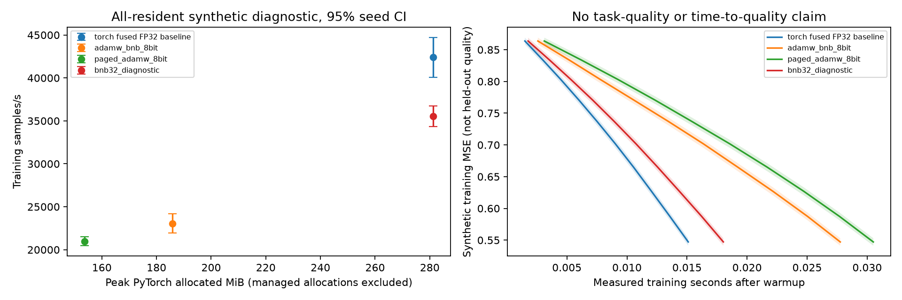

# Quantized optimizer design and qualification

Base: upstream main e644a833bf909af9c23a02a5c1069967dc501111 (fetched 2026-11-03).
Independent branch: feat/quantized-optimizers. QLoRA repository is read-only;
observed component a7fd524242f4f06ac488a3d96d331b1f46e2b385, PR 334 closed.
No equivalent optimizer backend found in main or the optimizer PR search.

## Design

Use bitsandbytes 0.49.2 AdamW8bit, with paging a separate public name. Do not
change model architecture or quantize weights. Require ordinary contiguous CUDA
FP32 trainables; BF16 forward uses explicit autocast. Frozen weights may have
other dtypes. No implicit master weights. Reject DTensor/FSDP/HSDP, low precision
trainables, sparse gradients, offload, and DCP until their ownership contracts are
implemented and qualified. Mainline release target: native posttrain SFT, HF model
builder, one CUDA device, consolidated transactional checkpoints.

Keep existing trainability, decay/LR groups and scheduler. Exact-name FP32 state
exceptions resolve against final trainables; reject missing/duplicate selectors.
Use instance-owned backend override and page managers, not process-global
registration. Backend percentile clipping remains 100 (disabled).

Snapshots synchronize and copy values into independent ordinary CPU tensors.
Restore validates backend/version, topology, precision, parameter names/shapes,
state policy and group identities before rebuilding backend allocations. Initialize
only recorded states, without an update. Paged moments are reallocated as managed
memory; lazy parameters remain lazy. Exported model state has no bnb requirement.
Report actual moment bytes and metadata after allocation, not selected names.

## Preregistered qualification (before measurements)

Initial budget: 8 GPU-hours including failed attempts; canaries first, at most
one new Slurm allocation at once, maximum 60 minutes per allocation. Do not touch
other campaigns. Stop large jobs on correctness failures or unavailable independent
evaluation data. Development kernels use paired seeds 17, 29, 43 and fused torch
FP32 AdamW; bnb32 is diagnostic only. Final comparisons require three paired seeds,
95% paired t confidence intervals across seeds, lower bound of speed ratio >1.05,
upper bound of held-out loss ratio <=1.01, and task score degradation <=0.01
absolute (or stricter existing workload criterion). Equal-budget quality gain
requires a positive lower confidence bound. State memory must decrease >=60% for
eligible large tensors; report total peak separately. No thresholds change after
results. Use five paired timing trials after warmup. Synthetic training canaries
are correctness/performance diagnostics, never multimodal quality qualification.

Final multimodal evaluation needs recording/trajectory-disjoint untouched data.
Existing WTS evaluation groups have been inspected; they cannot be reused as an
untouched test set. No release or speed/quality claim until all gates pass.

## Interface and current limits

Install the existing CUDA training environment plus `pip install '.[quantized-optimizers]'`.
Only canonical names are accepted (no `adamw_8bit` alias). Run:

```sh
SFT_MODEL_PATH=/immutable/model SFT_DATA_ROOT=/data \
IMAGINAIRE_OUTPUT_ROOT=/new/output \
torchrun --standalone --nproc-per-node=1 \
  -m cosmos_framework.posttrain.entrypoints.sft \
  --config cosmos_framework/posttrain/configs/sft_quantized_optimizer.py -- \
  rl.optimizer.name=adamw_bnb_8bit rl.optimizer.bnb_min_8bit_size=4096
```

`rl.optimizer.bnb_fp32_state_names=[model.some_layer.weight]` selects exact canonical
names from the final module, including wrapper prefixes. Missing, frozen, duplicate
and tied alias selectors are errors. Min-size exceptions are automatic. Trainability
is independent of state exceptions. Existing per-group LR and decay rules remain.
`impl` is torch-only; backend percentile clipping is disabled. AMSGrad, foreach,
fused and capturable are not backend config fields. Unknown typed fields fail.

| Contract | Implemented path / refusal |
|---|---|
| Model storage | No changes; frozen tensors may be BF16 or NF4 |
| Trainables / updates | Ordinary contiguous CUDA FP32 parameters, no extra masters |
| Compute | Recipe explicitly uses BF16 autocast |
| Moments | Blockwise uint8, FP32 exact-name/small-tensor exceptions |
| Paging | Separate name; upstream allocates managed moments for tensors >=100,000 elements |
| Parallelism | One GPU only; FSDP2, HSDP, replicated multi-rank and DTensor rejected |
| Recovery | Consolidated native transaction, same optimizer/version/policy/group mapping |
| Unsupported | DCP, sparse gradients, empty tensors, noncontiguous storage, offload, closures |
| Other factories | Legacy generator/reasoner/TOML paths retain their existing optimizer choices |

No broad distributed support or capacity-under-pressure claim. Upstream wrapping
quantization metadata in nested state dictionaries does not prove FSDP2 correctness.
The snapshot is a synchronized CPU value copy; managed allocation pointers are never
serialized. Loading does not step or initialize previously unused parameters.
Portable model exports do not depend on bitsandbytes optimizer state.

## Pinned implementation audit

Upstream `bitsandbytes/optim/optimizer.py` at 0.49.2 uses 256-element blocks,
FP32 maps/scales, and a 100,000-element managed-allocation threshold. Its loader
moves tensors but does not reconstruct managed allocations; the Cosmos adapter does.
Its step synchronizes after each parameter. This synchronization and quantization
work remain material bottlenecks in the all-resident diagnostic. This adapter does
not replace upstream arithmetic or synchronization with an unqualified fork.

Mainline source pins remain unchanged except the new bitsandbytes extra/lock entry:
Torch groups 2.10.0 CUDA 12.8/13.0 and optional 2.13.0 CUDA13.0. Local evidence uses
Torch 2.10.0+cu130 and bitsandbytes 0.49.2, on A100-SXM4-80GB.

Primary sources: [AdamW API](https://huggingface.co/docs/bitsandbytes/en/reference/optim/adamw),
[optimizer guide](https://huggingface.co/docs/bitsandbytes/en/optimizers),
[paging explanation](https://huggingface.co/docs/bitsandbytes/explanations/optimizers),
[Cosmos config](https://nvidia.github.io/cosmos-framework/posttrain/reference/config/).
Paging is CUDA managed memory, not disk offload. The Transformers `adamw_8bit`
alias names bitsandbytes, not Apex; this feature exposes only canonical names.

## Development evidence and unresolved gates

The A100 diagnostic uses 16,777,216 FP32 trainable elements, three paired seeds
(17/29/43), five repetitions, five warmup and ten measured updates, BF16 autocast,
batch 64. Fused torch AdamW is the product baseline; bnb32 is diagnostic only.
Actual uint8 moment arrays use 33,554,432 bytes; maps/scales add 526,336 bytes,
versus 134,217,728 bytes for two FP32 moments. There are no master-weight copies.
This is 74.6% less state, not 74.6% less training memory.

After the bounded finite-check optimization, nonpaged eight-bit achieves 0.544x
baseline throughput (95% paired-seed CI 0.540–0.548); paged achieves 0.495x
(0.479–0.511). Both FAIL the speed gate. PyTorch peaks are 281.3 MiB baseline,
185.8 MiB nonpaged, 153.8 MiB paged. The paged number excludes managed moment
allocations and must not be described as total-device memory. Raw device-used and
host high-water counters are diagnostic only; process-isolated host/device and
memory-pressure trials remain outstanding. The measured workload is synthetic;
its training loss is not held-out multimodal quality.



CUDA tests include fresh-process optimizer restoration (four subsequent updates,
bitwise equality on the same hardware), native SFT transaction restoration,
accumulation/clipping/scheduler/RNG/data cursor, partially lazy state, overrides,
frozen/tied membership, nonfinite/sparse rejection and invalid state restoration.
The focused suite passes 21 tests; two existing HF multi-device tests skip. No
multi-device support is inferred from these tests.

Integration-only CUDA canaries at `caf42ffc859e333ebd99737fb0d419e61c396c4f`
combine QLoRA `a7fd524242f4f06ac488a3d96d331b1f46e2b385` with optimizer `2131a42`.
They exercise BF16-base and NF4-base native adapters with fused FP32 AdamW,
nonpaged and paged eight-bit states. Only two adapter matrices enter the optimizer;
frozen base bytes remain unchanged. This small test does not meet the backend's
100,000-element paging threshold, and does not qualify full-model QLoRA recovery
or the requested task-quality factorial comparison.

The earlier WTS protocol uses NLL upper bound 1.02 and accuracy loss upper bound
0.01. The preregistered NLL bound here is stricter (1.01); no existing threshold
has been loosened. Final recording/trajectory-disjoint data are still required,
with an approved manifest, split/group IDs, media, answers, and a record that these
groups were not inspected or used in earlier optimization/evaluation. Do not
reuse the existing WTS validation group as an untouched final test set.

Next bounded experiment after correctness canaries: real-workload profiling under
a fixed memory cap, compare the largest fitting fused-baseline microbatch with the
largest fitting nonpaged microbatch at identical effective batch/data exposure.
Only continue to three-seed time-to-quality trials if this produces a plausible
end-to-end win on development data. Paging needs a separate pressure/resident
comparison with process GPU and host accounting. No release, speed, quality-gain,
or paging-capacity claim is made by this contribution.
